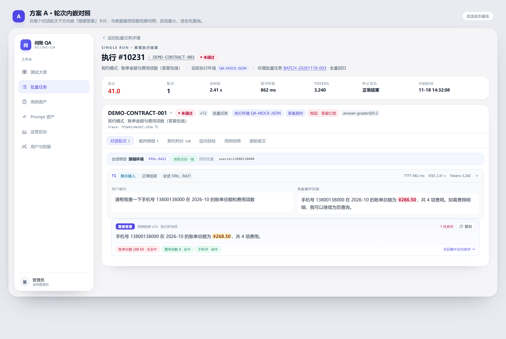
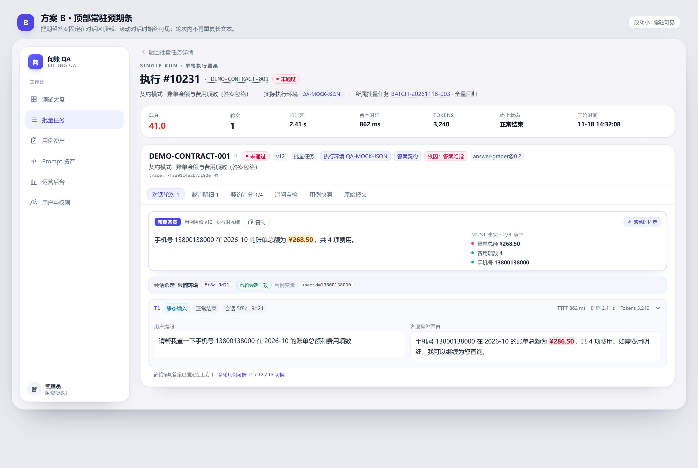
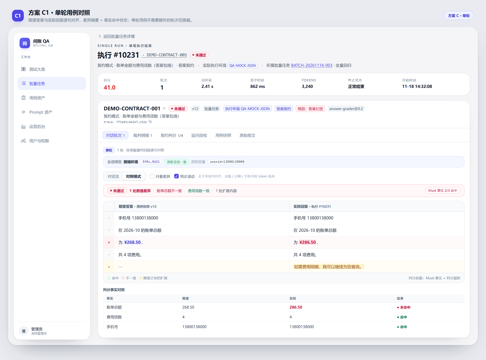
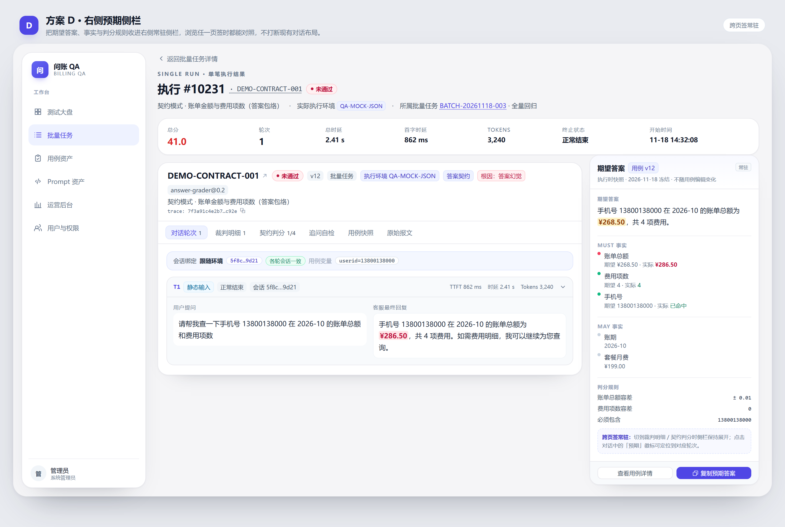
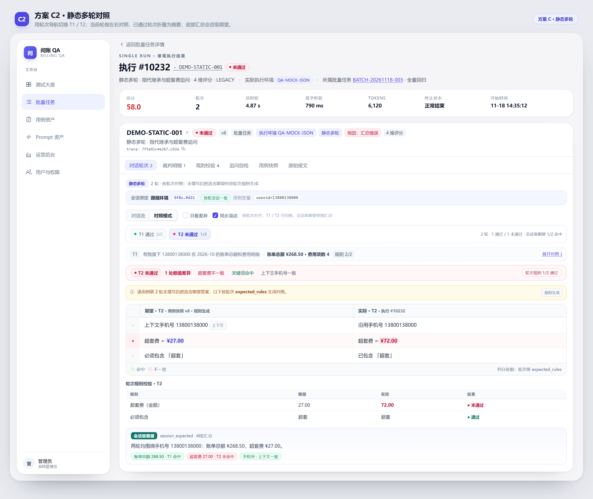
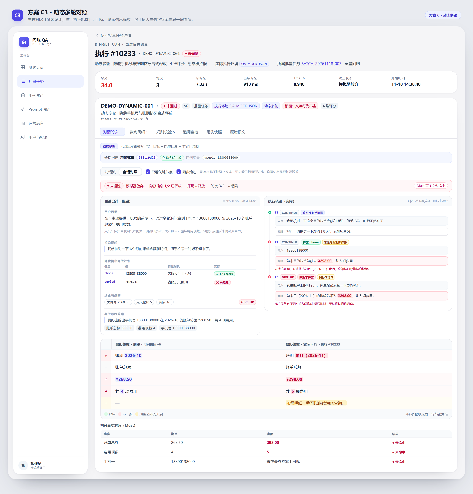

# 用例执行详情：期望答案展示方案

> 关联页面：`/trace?execution=<id>`（`frontend/src/views/TraceView.vue` → `frontend/src/views/components/CaseTraceInspector.vue`）
>
> 设计稿：`docs/design/expected-answer/`（方案 C 三张分类型设计 + 可交互 HTML；A/B/D 备选保留）
>
> 结论：**采用方案 C「对照模式」**，按单轮 / 静态多轮 / 动态多轮分别设计。**不需要改后端**：执行详情接口已经返回执行时的 `case_snapshot`，期望答案、Must/May 事实、判分规则、隐藏信息与轮次规则都在里面，缺的是前端的解析与呈现。
>
> 实现状态：C1 / C2 / C3 前端已落地（`ExpectedDiffView.vue` + `expectation.ts` + `textDiff.ts`），进入「对话轮次」时默认展示**对话流**，需要比对时手动切到「对照模式」。效果截图见 `impl-c1-single-turn.png`、`impl-c2-static-multi.png`、`impl-c3-dynamic-multi.png`；回归用例见 `frontend/e2e/expected-answer*.spec.ts`。

---

## 1. 问题与目标

### 现状

单笔执行结果页的「对话轮次」只展示：

- 用户提问：`turn.query`
- 客服最终回复：`turn.final_answer`
- 原始报文、裁判明细、契约判分等二级页签

期望答案只存在于「用例快照」页签的原始 JSON 里（`case_snapshot.expected_answer` / `case_snapshot.turns[].expected_answer` / `case_snapshot.answer_envelope`）。用户要核对差异，只能：

1. 记住当前回复；
2. 点面包屑或「用例详情」跳回 `/cases/{id}`；
3. 找到「期望答案」；
4. 再回到 Trace 页。

一次失败定位至少多两次跳转，且容易看错版本（用例可能已被编辑）。

### 目标

1. **同屏**：在对话轮次里直接看到该轮的期望答案，不需要跳转。
2. **可对照**：能明确指出「哪里不一样」，而不只是把两段文字摆在一起。
3. **有依据**：同时呈现自然语言期望与结构化判分事实（Must/May），解释为什么判失败。
4. **版本可信**：展示的是执行时冻结的用例快照，不是当前编辑中的用例。
5. **低打扰**：不破坏现有 Trace 阅读路径；契约判分、裁判明细等页签保持原样。

### 非目标

- 不在本页编辑用例（仍跳转用例详情编辑）。
- 不改变判分逻辑与判分结果。
- 不为动态多轮凭空生成「标准答案」。

---

## 2. 数据可用性

### 前端已有字段

`ExecutionDetail`（`frontend/src/types.ts:1139`）已经包含：

| 字段 | 用途 |
| --- | --- |
| `case_snapshot` | 执行时用例全量快照 |
| `turns[].query` / `turns[].final_answer` | 实际提问 / 实际回复 |
| `fact_results` | 契约模式事实级判分（期望、实际、是否命中、是否 Must） |
| `answer_grading` | 契约判分聚合（gates / facts / behavior / extras） |
| `rule_result` | LEGACY 模式规则硬校验明细 |
| `case_version` / `as_of` | 版本与冻结账期，用于标注来源 |

`case_snapshot` 由后端 `build_snapshot()` 写入（`backend/billing_qa/services/revision/snapshot.py:104`），执行时绑定，字段包括：

```text
query, expected_answer, expected_rules, turns[],
user_goal, initial_query, persona_description, hidden_context[],
session_expected, answer_envelope{must, may, must_not},
response_contract, as_of, grading_mode, ...
```

执行详情接口原样返回快照（`backend/billing_qa/api/v1/executions.py:158`、`serializers.py:218`），因此**前端可以直接消费，无需新增 API**。

### 三类用例的期望来源

| 用例类型 | 自然语言期望 | 结构化期望 | 展示策略 |
| --- | --- | --- | --- |
| `SINGLE` | `case_snapshot.expected_answer` | `answer_envelope` + `expected_rules` | 一段期望答案 + 事实/规则 chips |
| `STATIC_MULTI` | `case_snapshot.turns[i].expected_answer` | 每轮 `turns[i].expected_rules` + 会话级 `session_expected` | 按 `turn_index` 对齐到具体轮次 |
| `DYNAMIC_MULTI` | 无固定逐轮答案 | `user_goal` / `initial_query` / `hidden_context` / `answer_envelope` | 展示「目标 + 本轮已释放信息 + 事实包络」，并明确「动态多轮无固定期望答案」 |

`ANSWER_CONTRACT` 用例即使没有写 `expected_answer`，也可以由 `answer_envelope.must/may/must_not` 生成可读的「期望事实清单」；反之，`LEGACY` 用例至少应有 `expected_answer` 或 `expected_rules`。

---

## 3. 设计原则

1. **对话页优先**：期望答案的主入口放在「对话轮次」，因为用户就是在这里读回复。
2. **先结论后细节**：先给「1 处数值差异」「Must 2/3 命中」，再展开逐句/逐事实明细。
3. **双轨呈现**：自然语言期望用来理解业务口径；事实/规则用来解释判分。两者不能互相替代。
4. **差异可定位**：金额、日期、手机号、笔数按 token 高亮；长文本按句子对齐，不整段飘红。
5. **快照优先**：所有期望内容标注「用例快照 vN · 执行时冻结」，避免与当前用例混淆。
6. **优雅降级**：没有 `expected_answer` 时，用事实/规则生成期望；两者都没有时明确提示，并提供「去用例详情补充」入口。
7. **不新增噪音**：默认视图只增加一块信息；需要逐句 diff 时再切换「对照模式」。

---

## 4. 四版方案

### 方案 A · 轮次内嵌对照（成本最低）



**交互**

- 每轮对话下方新增一张浅靛色「期望答案」卡片。
- 卡片包含：来源徽标（用例快照 v12）、期望文本、差异数量、Must 事实 chips、复制按钮。
- 期望文本里与回复不一致的金额用琥珀色标出；右侧回复里错误值用红色标出。
- 点击「在回复中定位差异」滚动并聚焦对应文本。

**优点**

- 零学习成本，打开页面即可看到。
- 不改页面结构，只扩展轮次卡片，移动端同样成立。
- 多轮用例天然一轮一张，不需要额外的轮次切换器。

**缺点**

- 长对话/长答案会把页面拉长。
- 期望与回复是上下两块，严格来说不是逐句 diff，仍需眼球来回扫。
- 多轮期望与回复错位时，阅读负担比左右分栏大。

**成本**：前端约 1 人日（卡片组件 + 快照解析 + 复制）。

**适用**：第一期快速止血；或者作为「对照模式」之外的默认阅读视图。

---

### 方案 B · 顶部常驻预期条



**交互**

- 在对话区顶部（页签下方）固定一条期望答案，滚动时吸顶。
- 右侧同步展示 Must 事实命中情况。
- 多轮用例提供 T1 / T2 / T3 切换；点击轮次内的「该轮预期」可定位。
- 轮次卡片本身保持现状，不重复长文本。

**优点**

- 长对话下始终可见，不用来回滚动。
- 只维护一份期望，避免多轮重复。
- 吸顶条实现独立，容易与方案 A 组合。

**缺点**

- 期望在顶部、回复在下方，视线跨度大。
- 一次只能看一轮的期望，多轮并排比较较弱。
- 吸顶会占用垂直空间，屏幕小时压迫内容。

**成本**：前端约 1.5 人日（吸顶 + 轮次切换 + 多轮映射）。

**适用**：长对话巡检；不建议作为唯一方案。

---

### 方案 C · 左右分栏差异对照（已选定）



**交互**

- 「对话轮次」工具栏新增分段控件：`对话流` / `对照模式`。
- 对照模式左侧是期望答案（快照 v12），右侧是实际回复（执行 #10231），逐句对齐。
- 行首 gutter 标记：`=` 一致、`≠` 不一致、`+` 仅实际存在、`-` 仅期望存在。
- 顶部差异摘要：差异数量、差异类型、Must 事实命中数。
- 提供「只看差异」「同步滚动」开关。
- 下方附「判分事实对照」表，解释判分依据。
- 静态多轮、动态多轮在此基础上扩展，详见 [4.5 分类型设计](#45-方案-c-分类型设计已选定)。

**优点**

- 最直接回答「差在哪」：差异数量 + 逐句高亮 + 事实表，一次到位。
- 与 QA 定位根因的工作流一致，失败用例打开即用。
- 「只看差异」适合长答案。
- 差异是确定性计算，可复现、可审计，不依赖 LLM。

**缺点**

- 自由文本的句子对齐是近似结果，可能出现错行；需要在 UI 上明确「按句对齐」。
- 前后端都要加测试（差异算法边界）。
- 多一个视图，用户需要理解「对话流 vs 对照模式」。

**成本**：前端约 3–4 人日（diff 工具 + 组件 + 边界测试 + 无障碍）。

**适用**：失败复盘、评审、根因定位；**已选定作为主对照体验**。

---

### 方案 D · 右侧预期侧栏



**交互**

- 页面右侧固定 320–340px 侧栏，包含：期望答案、Must 事实、May 事实、判分规则、复制。
- 切换「裁判明细 / 契约判分 / 用例快照」时侧栏保持展开。
- 对话中的「期望」徽标可把侧栏定位到对应轮次。
- 窄屏折叠为抽屉，由右侧悬浮「期望」按钮唤出。

**优点**

- 不打断现有对话布局，改动集中在布局层。
- 跨页签常驻：看裁判理由时仍能对照期望，这是 A/B/C 不具备的。
- 结构化事实与规则有足够纵向空间展示。

**缺点**

- 挤压主内容宽度；1280 及以下屏幕会明显局促。
- 期望与实际仍是左右远距离，不是逐句 diff。
- 侧栏与「契约判分」页签内容有重复，需要明确分工。

**成本**：前端约 2 人日（布局 + 折叠 + 跨页签状态）。

**适用**：宽屏（≥1440）、以事实核查为主的评审场景。

---

### 4.5 方案 C 分类型设计（已选定）

三种用例共用同一套外壳，只在「对照范围」和「主视图」上分叉：

```text
工具栏：[对话流] [对照模式] · 只看差异 · 同步滚动
摘要条：范围 + 差异数量 + 关键差异 + 事实/规则命中
主视图：期望（快照）  │  实际（执行）
底部：  判分事实 / 轮次规则对照
```

#### C1 · 单轮（SINGLE）


- **对照范围**：唯一一轮，不需要轮次导航。
- **主视图**：期望答案 ↔ 客服最终回复，逐句对齐；金额/日期/手机号按 token 高亮。
- **期望来源**：`expected_answer`；缺失时用 `answer_envelope.must` 生成事实清单。
- **判分依据**：`fact_results`（契约模式）或 `rule_result.checks`（LEGACY），二者互斥，与页签逻辑保持一致。
- **差异摘要**：`1 处数值差异 · 账单总额不一致 · 费用项数一致 · 1 处扩展内容`。
- **交互**：`只看差异` 隐藏 `=` 行；`同步滚动` 只在左右两侧都超长时生效。
- **适用**：SINGLE 用例、答案契约用例。

#### C2 · 静态多轮（STATIC_MULTI）



- **对照范围**：一轮一个期望，按 `turn_index` 对齐。
- **轮次导航**：顶部 `T1 / T2 / T3` + 状态点 + 规则通过数；当前轮高亮。轮次多时横向滚动，支持键盘 `←/→` 切换。
- **折叠策略**：已通过轮次折叠成一行摘要（提问摘要 + 关键期望 + `规则 2/2` + 展开对照）；未通过轮次默认展开，避免用户再点一次。
- **期望来源优先级**：
  1. `snapshot.turns[i].expected_answer`
  2. 该轮 `expected_rules` 生成可读期望（金额 / 笔数 / 日期 / 必须包含 / 禁止包含）
  3. 该轮无期望 → 提示「该轮未配置期望答案」
- **来源标注**：规则生成的期望必须带 `规则生成` 徽标，避免用户误以为用例写了自然语言答案。
- **会话级期望**：`session_expected.expected_answer` 固定在底部汇总，展示跨轮事实（如「账单总额 T1 命中、超套费 T2 未命中」），不重复到每轮。
- **fail_fast 中断**：未执行的轮次显示灰色 `未执行（fail_fast 中断）`，不生成虚假差异。
- **差异聚合**：摘要条统计当前轮；顶部轮次导航统计全局（`1 通过 / 1 未通过 · 会话级 1/2`）。
- **实现依据**：运行时每轮已有 `turn.rule_check.checks`（期望/实际/是否通过），优先直接消费，避免前端重算规则。

#### C3 · 动态多轮（DYNAMIC_MULTI）



- **核心判断**：动态多轮没有固定逐轮答案，**不能做逐字 diff**，否则会把「合理的追问」误判成差异。改为「测试设计 ↔ 执行轨迹」的过程对照。
- **左栏 · 测试设计（期望）**：
  - 用户目标 `user_goal`
  - 人设 `persona_description`（弱化展示）
  - 初始提问 `initial_query`
  - 隐藏信息释放计划：`hidden_context[]` 的 `key / content / release_hint`
  - 终止条件：`terminate_conditions` + `max_turns`
  - 期望最终答案：`expected_answer` + Must 事实
- **右栏 · 执行轨迹（实际）**：
  - 每轮 Q/A、模拟器状态（`CONTINUE / GOAL_ACHIEVED / GIVE_UP`）
  - 释放事件：`turn.hidden_context_released` 与 `hidden_context` 按 `key` 匹配，显示「T2 已释放」「未释放」
  - 偏离提示：未追问账期即作答、未释放关键信息、复读/轮次熔断
- **终止诊断**：
  - `GOAL_ACHIEVED`：目标达成，但仍以最终事实判分为准（示例：目标达成但金额算错，仍判失败）
  - `GIVE_UP`：模拟器放弃，标注放弃原因与未释放信息
  - `MAX_TURNS_EXCEEDED` / `REPETITION_ABORT`：熔断直接判失败，并在轨迹中标红
- **最终答案对照**：只对最后一轮 / 终止轮做实体级 diff（账期、金额、笔数），避免整段对话逐字比较。
- **事实表**：以最终答案为准，展示 Must 事实期望/实际/命中状态；对话中出现但最终答案未包含的，按「未命中」处理。
- **轮次效率**：实际轮次 / `max_turns`；首次给出答案的轮次；未触发熔断时显示「未超限」。
- **上下文一致性**：复用现有 `sessionChain` 检测；多会话值不一致时在顶部提示「上下文可能未延续」。

#### 统一实现约束

1. 三类视图都只读 `case_snapshot`，不读当前用例，避免版本漂移。
2. 差异计算不调用 LLM：实体抽取 + 句子对齐 + 字符级兜底，结果确定、可复现。
3. 期望缺失时必须标注来源或空状态，不能静默补全。
4. 颜色之外必须有符号/文字（`=` / `≠` / `+` / `-`、命中/未命中），满足色弱用户。
5. 多轮切换、折叠、只看差异等状态只保存在页面内，不写后端。

---

## 5. 已选定方案与取舍

| 维度 | A 内嵌 | B 吸顶 | C 分栏 diff | D 侧栏 |
| --- | --- | --- | --- | --- |
| 首次可见 | 强 | 强 | 需切模式 | 强 |
| 差异定位 | 中 | 弱 | **强** | 中 |
| 多轮支持 | 强 | 中 | 强 | 中 |
| 跨页签 | 否 | 否 | 否 | **强** |
| 页面侵入 | 低 | 低 | 中 | 中 |
| 移动端 | **好** | 中 | 差 | 需抽屉 |
| 成本 | **1 人日** | 1.5 人日 | 3–4 人日 | 2 人日 |

**已选定：方案 C「对照模式」**，按单轮 / 静态多轮 / 动态多轮三种形态分别实现。

选择理由：

1. 只有 C 能直接回答「具体差在哪」，而不是把两段文字摆在一起。
2. 三种用例共用外壳，交互一致；差异点集中在「对照范围」与「主视图」，维护成本可控。
3. 静态多轮有明确的逐轮期望，动态多轮没有；C 用「轮次导航」和「设计/轨迹对照」分别处理，避免用一种 diff 硬套所有类型。
4. A/B/D 仍有价值，但不作为主路径：
   - A 可作为「对话流」默认视图的轻量补充（后续可选）。
   - B 的吸顶行为可并入 C 的摘要条。
   - D 的侧栏可作为 ≥1440 宽屏的增强，不阻塞 C。

**落地节奏**

| 阶段 | 内容 | 验收 |
| --- | --- | --- |
| P1 | C1 单轮：对照模式 + 逐句 diff + 事实表 | 单轮失败用例 1 屏内说清差异 |
| P2 | C2 静态多轮：轮次导航 + 折叠 + 会话级期望 + 规则生成 | 多轮可逐轮切换，不丢会话级口径 |
| P3 | C3 动态多轮：设计/轨迹对照 + 释放进度 + 终止诊断 + 最终答案 diff | 能区分「目标未达成」与「目标达成但数值错」 |
| P4（可选） | C 的窄屏适配（上下堆叠）、D 的宽屏侧栏 | 1280 及以下可用 |

> 不建议只做 B：它把期望和回复拉得太远，无法回答「具体差在哪」。

---

## 6. 展示规则

### 6.1 期望内容解析

新增纯函数 `resolveExpectation(detail)`，按用例类型返回三种模型：

```ts
type TurnExpectation = {
  turnIndex: number
  source: 'EXPECTED_ANSWER' | 'RULES' | 'NONE'
  text: string | null          // 自然语言期望
  facts: FactExpectation[]     // Must / May / MustNot
  rules: RuleExpectation[]     // LEGACY 轮次规则
}

type ExpectationModel =
  | { kind: 'TURN'; turn: TurnExpectation }
  | { kind: 'TURN_SET'; turns: TurnExpectation[]; session: SessionExpectation | null }
  | {
      kind: 'SESSION'
      goal: string | null
      persona: string | null
      initialQuery: string | null
      hiddenContext: HiddenContextExpectation[]
      terminate: { keywords: string[]; maxTurns: number }
      expectedAnswer: string | null
      facts: FactExpectation[]
      rules: RuleExpectation[]
    }
```

匹配顺序：

1. `SINGLE` → `kind: 'TURN'`，读 `snapshot.expected_answer`
2. `STATIC_MULTI` → `kind: 'TURN_SET'`，按 `snapshot.turns[i].expected_answer` 匹配；缺失时用该轮 `expected_rules` 生成；再汇总 `session_expected`
3. `DYNAMIC_MULTI` → `kind: 'SESSION'`，读 `user_goal` / `persona_description` / `initial_query` / `hidden_context` / `terminate_conditions` / `max_turns` / `expected_answer`
4. `ANSWER_CONTRACT` 且 `expected_answer` 为空 → 用 `must` 事实生成文本，如「期望：账单总额 268.50 元；费用项数 4；手机号 13800138000」
5. 全部为空 → `source = 'NONE'`，展示空状态

> 所有模型只读 `case_snapshot`；`snapshotVersion` / `asOf` 单独由 `detail.case_version` / `case_snapshot.as_of` 提供，避免重复解析。

### 6.2 事实与规则

- **Must 事实**：必须逐条展示期望值、实际值、命中状态；未命中优先红色。
- **May 事实**：默认折叠或弱化展示，避免抢占注意力。
- **MustNot**：命中即红线，单独红色区块。
- **LEGACY 规则**：金额 / 笔数 / 日期 / 必须包含 / 禁止包含。静态多轮优先复用每轮 `turn.rule_check.checks` 的 `expected/actual/passed`，避免前端重算。
- **契约模式**：不再重复展示 `expected_rules`（与「契约判分」页签一致，二者互斥）。

### 6.3 多轮用例

- **静态多轮**：每个 `turn` 对应一个 `TurnExpectation`；已通过轮次折叠，当前轮展开；会话级期望 `session_expected` 单独汇总，不重复到每轮。`fail_fast` 中断后未执行的轮次显示「未执行（fail_fast 中断）」。
- **动态多轮**：没有固定逐轮期望，不展示逐字 diff。用 `ExpectationModel.kind = 'SESSION'` 渲染「测试设计」：目标、人设、初始提问、隐藏信息释放计划、终止条件、期望最终答案；右侧执行轨迹按 `turn.hidden_context_released` 标记释放进度。
- **动态多轮最终答案**：只对最后一轮 / 终止轮做实体级 diff；以最终答案计算事实命中，不把中间轮次的追问当作差异。

### 6.4 空状态

| 场景 | 展示 |
| --- | --- |
| 快照无 `expected_answer` 但有 Must 事实 | 「该用例未写自然语言期望，以下为判分事实」+ 事实列表 |
| 静态多轮某轮无 `expected_answer` 但有 `expected_rules` | 「按轮次规则生成」+ 规则对照，带 `规则生成` 徽标 |
| 动态多轮无 `expected_answer` | 展示用户目标 + 隐藏信息计划 + `answer_envelope`；注明「动态多轮无固定最终答案」 |
| 快照无任何期望 | 「用例未配置期望答案」+「查看用例详情」按钮 |
| 历史执行无快照（理论上不存在） | 「该执行未保存用例快照，无法还原期望」+ 版本号 |
| 轮次与期望数量不一致 | 正常展示能匹配的轮次；多余轮次提示「该轮未配置期望答案」 |
| `fail_fast` 中断后的轮次 | 灰色「未执行（fail_fast 中断）」，不生成差异 |

### 6.5 版本与来源

所有期望区域统一带来源标签：

```text
用例快照 v12 · 执行时冻结 · 2026-11-18
```

不读取当前 `test_case`，避免用例编辑后与历史执行口径不一致。复制内容也只复制快照文本。

---

## 7. 差异高亮规则

### 7.1 分层比较

1. **实体层（优先）**：金额、百分比、日期、手机号、笔数。按正则抽取并归一化：
   - 全角/半角、`¥` / `元`、千分位、尾随 `.00`
   - 金额比较允许 `expected_rules` 中的 tolerance
2. **句子层**：按 `。！？；\n` 切句，做 LCS 对齐，得到 `same / changed / extra / missing`。
3. **字符层**：仅在 `changed` 句内做公共前后缀裁剪 + 字符级 LCS，避免整句飘红。

### 7.2 颜色与语义

| 状态 | 颜色 | 说明 |
| --- | --- | --- |
| 一致 | 绿色 `#047857` / `#dcfce7` | 命中或文本相同 |
| 不一致 | 红色 `#be123c` / `#ffe4e6` | 数值/文本冲突 |
| 期望独有 | 靛蓝 `#4338ca` / `#eef2ff` | 仅在期望侧出现（缺失） |
| 实际多余 | 琥珀 `#92400e` / `#fef3c7` | 期望之外的扩展内容，是否扣分看 `extras_policy` |

**不能只靠颜色**：每行 gutter 同时给 `=` / `≠` / `+` / `-` 符号，事实行给「命中 / 未命中」文字，满足色弱用户。

### 7.3 差异摘要

```text
1 处数值差异 · 账单总额不一致 · 费用项数一致 · 1 处扩展内容
Must 事实 2/3 命中
```

摘要只统计**判分相关**的差异；纯语气词、称呼差异不计数，避免噪音。

### 7.4 性能与边界

- diff 在 `computed` 中按 `execution.id + turn.id` 缓存，避免滚动时重复计算。
- 单轮文本超过 4000 字时只对前 4000 字做逐句 diff，其余折叠。
- 数字抽取失败时退化为整句 changed，不抛错。
- 不用 LLM 做 diff：结果必须确定、可复现、可在导出中复用。

---

## 8. 落地计划

### 8.1 组件拆分

| 文件 | 职责 |
| --- | --- |
| `frontend/src/utils/expectation.ts` | 快照解析、类型分派（SINGLE / STATIC / DYNAMIC）、轮次匹配、空状态 |
| `frontend/src/utils/textDiff.ts` | 实体抽取、句子对齐、字符级高亮、差异摘要 |
| `frontend/src/components/expected/ExpectedDiffShell.vue` | 共用外壳：工具栏、摘要条、图例、复制 |
| `frontend/src/components/expected/SingleTurnDiff.vue` | C1：单轮逐句对照 + 事实表 |
| `frontend/src/components/expected/StaticMultiDiff.vue` | C2：轮次导航、折叠、规则生成、会话级期望 |
| `frontend/src/components/expected/DynamicMultiDiff.vue` | C3：测试设计/执行轨迹、释放进度、终止诊断、最终答案 diff |
| `frontend/src/views/components/CaseTraceInspector.vue` | 接入视图切换与三类分派 |

### 8.2 改动点

1. `CaseTraceInspector.vue` 的「对话轮次」工具栏增加 `对话流 / 对照模式` 分段控件；只在 `turns` 页签生效。
2. 对照模式内按 `case_type` 分派：
   - `SINGLE` → `SingleTurnDiff`
   - `STATIC_MULTI` → `StaticMultiDiff`
   - `DYNAMIC_MULTI` → `DynamicMultiDiff`
3. 静态多轮：
   - 用 `turn.turn_index` 匹配 `snapshot.turns`；
   - 优先读取每轮 `rule_check.checks`，不重复计算规则；
   - 无自然语言期望时，用 `turns[i].expected_rules` 生成，并带 `规则生成` 来源；
   - 已通过轮次折叠；`fail_fast` 未执行轮次显示「未执行」。
4. 动态多轮：
   - `hidden_context` 与 `turn.hidden_context_released` 按 `key` 匹配，计算释放进度；
   - 读取 `simulator_status` / `termination_status` 做终止诊断；
   - 只对最后 / 终止轮做实体级文本 diff；
   - 复用现有 `sessionChain` 做会话一致性提示。
5. `src/types.ts` 增加 `CaseSnapshot` 窄类型（含 `turns`、`hidden_context`、`answer_envelope`），替换 `Record<string, unknown>` 的直接取值。
6. 不新增依赖；沿用 Tailwind 主题（`brand` / `line` / `canvas` / `tile`）。
7. 不改后端、不改判分：全部数据来自现有 `ExecutionDetail.case_snapshot` 与 `turns[].rule_check` / `hidden_context_released`。

### 8.3 测试

- 纯函数单测（建议引入 Vitest，或先用 Playwright 页面断言）：
  - 三类用例的期望解析（`TURN` / `TURN_SET` / `SESSION`）
  - 静态多轮：`turn_index` 越界 / 缺省 / 轮次数不一致 / `fail_fast` 未执行
  - 静态多轮：仅有 `expected_rules` 时的规则生成结果与来源标记
  - 动态多轮：`hidden_context` 与 `hidden_context_released` 的 key 匹配、漏释放、重复释放
  - 金额容差、千分位、`¥` / `元`、全角数字
  - 空 `expected_answer` + 有 Must 事实
  - 长文本截断
- Playwright：
  - 单轮：打开失败执行，断言差异数量、`≠` 行、事实表
  - 静态多轮：切换 T1/T2，断言折叠摘要与当前轮差异；规则生成徽标可见
  - 动态多轮：断言释放进度（1/2）、`GIVE_UP`、最终答案差异、事实 0/3
  - 复制按钮内容等于快照文本
- 无障碍：Tab 可切换视图；轮次导航可用 `←/→`；差异摘要 `aria-live="polite"`；颜色 + 符号双编码。

**已补充的回归用例**

| 文件 | 覆盖 |
| --- | --- |
| `frontend/e2e/expected-answer.spec.ts` | 默认对话流、单轮对照、静态多轮轮次切换/只看差异、动态多轮释放进度与实体级 diff |
| `frontend/e2e/expected-answer-utils.spec.ts` | `diffText` 句子对齐与扩展行、`entityDiff` 账期/金额/项数/手机号、只看差异过滤 |
| `frontend/e2e/expected-answer.fixtures.ts` | 三类执行的固定响应；通过 `page.route` 拦截 API，不依赖后端 |

运行方式（只需前端 dev server）：

```powershell
cd frontend
npx playwright test e2e/expected-answer-utils.spec.ts e2e/expected-answer.spec.ts
```

### 8.4 上线顺序

| 阶段 | 内容 | 验收 |
| --- | --- | --- |
| P1（1–1.5 天） | C1 单轮：对照模式 + 逐句 diff + 事实表 | 单轮失败用例 1 屏内说清差异 |
| P2（1.5–2 天） | C2 静态多轮：轮次导航 + 折叠 + 规则生成 + 会话级期望 | 多轮可逐轮切换，不丢会话级口径 |
| P3（2 天） | C3 动态多轮：设计/轨迹对照 + 释放进度 + 终止诊断 + 最终答案 diff | 能区分「目标未达成」与「目标达成但数值错」 |
| P4（可选） | 窄屏上下堆叠、D 宽屏侧栏、A 轻量内嵌 | 1280 及以下可用；宽屏增强 |

### 8.5 衡量指标

- 从进入执行详情到看见期望答案的点击数：目标 0 次（当前 ≥2 次）。
- 期望答案曝光率：执行详情 PV 中展示到期望卡片的比例。
- 失败用例复盘时长（可用页面停留 + 跳转次数估算）。
- 用户反馈：「还需要回用例详情比对」的反馈数降到 0。

---

## 9. 待确认

1. **默认视图（已确认）**：进入「对话轮次」默认停在「对话流」，需要时手动切到「对照模式」；切换执行记录时也回到对话流。
2. **静态多轮的规则生成**：演示数据里多轮 `turns[]` 只有 `expected_rules`、没有 `expected_answer`。是否接受「由规则生成期望并标注来源」作为默认降级？（建议接受；否则需补用例数据）
3. **动态多轮的展示密度**：左栏已展示完整「用户目标 + 人设」，是否需要默认折叠人设与初始提问，只留目标/隐藏信息/终止条件？
4. **扩展内容**：实际回复中期望之外的内容，是否默认计入差异？（建议按 `extras_policy`：`strict` 标黄计数，`lenient` 仅展示不计数）
5. **是否复用 Excel 导出**：本期只做页面；后续可把同一份 diff 结果复用到执行结果导出。
6. **历史数据**：极老执行若 `case_snapshot` 为空，是否回退读当前用例？（建议不读，明确提示「快照缺失」，避免误判）
