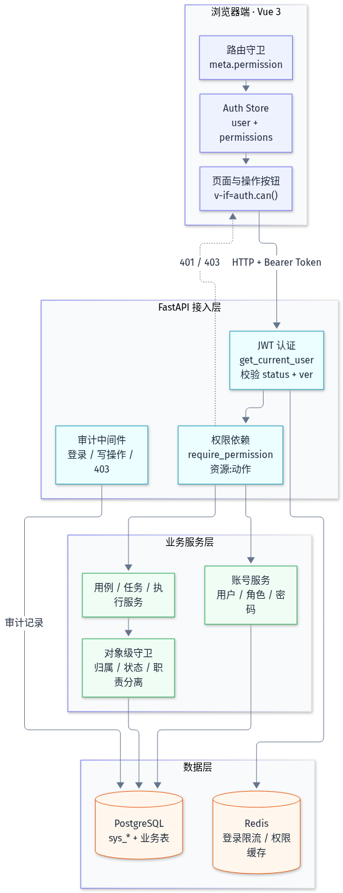
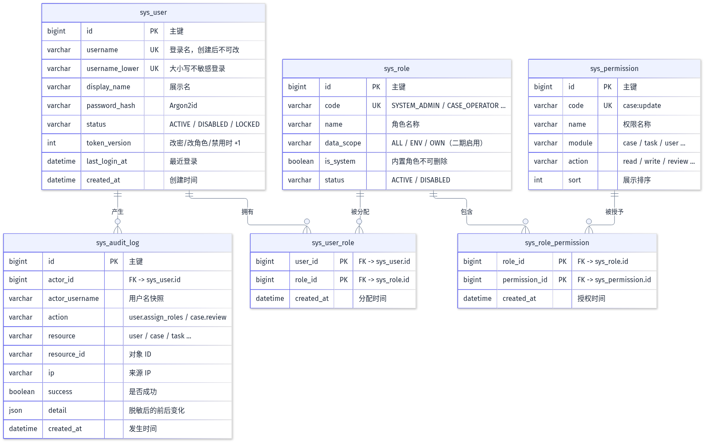
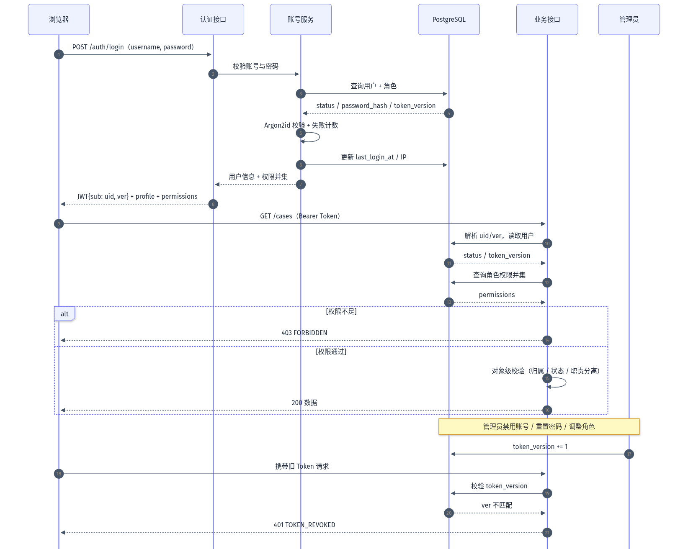
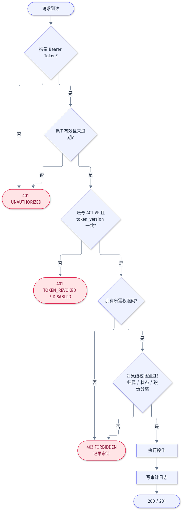

# 用户与权限管理系统 · 关键设计图

> 配套文档：[用户与权限管理系统 · 关键设计](./USER_MANAGEMENT_DESIGN.md)
>
> 图片源文件位于 `docs/design/user-management/`：`.mmd` 为可维护的 Mermaid 源文件，`.svg` 为矢量版，`.png` 为高清位图。

---

## 图 1：总体架构与鉴权链路

**看图要点：**

1. **前端三层**：`Auth Store` 保存用户与权限；路由守卫按 `meta.permission` 拦截；页面按钮用 `can()` 裁剪。前端只负责体验，不承担安全裁决。
2. **接入层顺序**：先 `JWT 认证`（账号状态 + Token 版本），再 `权限依赖`（权限码），最后进入业务服务。
3. **业务服务层**：权限码通过后，还要做对象级校验（创建人、冻结状态、职责分离）。
4. **数据层**：PostgreSQL 存 RBAC 与审计；Redis 承担登录限流与权限缓存。
5. 任何一层不通过，统一返回 401 / 403，并写入审计。

[矢量版 SVG](./design/user-management/01-architecture.svg) · [Mermaid 源文件](./design/user-management/01-architecture.mmd)

---

## 图 2：权限数据模型（ER）

**看图要点：**

1. 核心是 5 张 RBAC 表：`sys_user`、`sys_role`、`sys_permission`、`sys_user_role`、`sys_role_permission`。
2. `sys_user.token_version` 是“旧 Token 立即失效”的关键字段。
3. `sys_permission.code` 唯一，命名固定为 `资源:动作`，代码与数据库保持同步。
4. `sys_audit_log` 通过 `actor_id` 关联用户，同时保存 `actor_username` 快照，避免用户停用或改名后审计断链。
5. 现有业务表继续保留 `created_by` / `operator` 用户名字符串，用于归属判断和历史兼容，不强制改成外键。

[矢量版 SVG](./design/user-management/02-data-model.svg) · [Mermaid 源文件](./design/user-management/02-data-model.mmd)

---

## 图 3：登录、鉴权与 Token 失效时序

**看图要点：**

1. 登录成功后签发 `JWT{sub: uid, ver}`，**不放角色和权限快照**。
2. 每次业务请求都重新校验账号状态与 `token_version`，并加载角色权限并集。
3. 权限不足返回 403；对象级校验失败同样返回 403。
4. 管理员禁用账号、重置密码或调整角色时，`token_version += 1`，旧 Token 下一次请求立即 401。

[矢量版 SVG](./design/user-management/03-login-token.svg) · [Mermaid 源文件](./design/user-management/03-login-token.mmd)

---

## 图 4：单次请求授权决策流程

**看图要点：**

1. **默认拒绝**：没有 Token、Token 无效、账号不可用、版本不一致，全部拒绝。
2. 认证与授权分开：401 表示“你是谁不确定”，403 表示“知道你是谁，但你不能做”。
3. 权限码只解决“能不能做这个动作”；对象级校验解决“能不能对这条数据做”。
4. 只有全部通过才执行操作，操作完成后写审计日志。

[矢量版 SVG](./design/user-management/04-authorization-flow.svg) · [Mermaid 源文件](./design/user-management/04-authorization-flow.mmd)

---

## 图与文档的对应关系

| 图 | 对应设计章节 |
| --- | --- |
| 图 1 总体架构 | 第 6 章 后端鉴权落地、第 8 章 前端设计 |
| 图 2 数据模型 | 第 4 章 数据模型 |
| 图 3 登录与 Token 失效 | 第 5 章 认证与会话设计 |
| 图 4 授权决策流程 | 第 3 章 权限模型、第 6.5 节 错误语义 |

界面设计稿见：[用户与权限管理系统 · 界面设计](./USER_MANAGEMENT_UI.md)。
