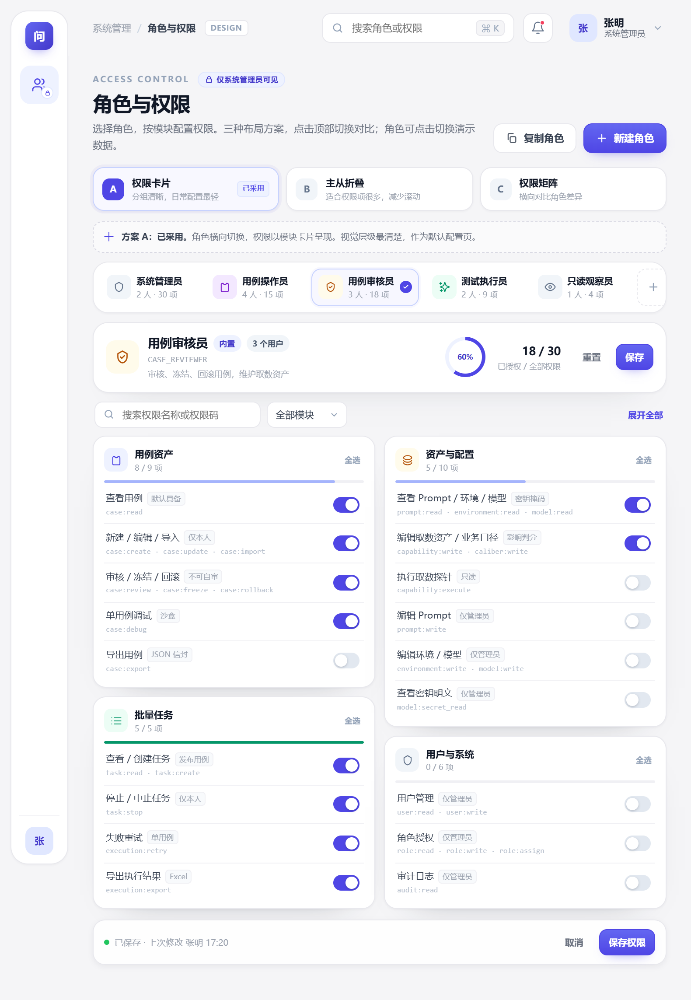
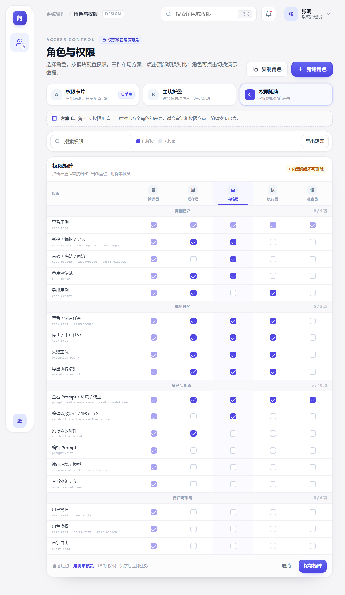

# 角色与权限 · 界面方案对比

> 可交互对比稿：[`docs/design/user-management/role-designs.html`](./design/user-management/role-designs.html)
>
> 打开后可在顶部切换 A / B / C 三套方案，点击角色可切换演示数据。
>
> **当前已采用方案 A「权限卡片」**，并合入主界面 `ui-design.html`；B / C 作为后续备选保留。

---

## 为什么改

当前权限管理页主要有四个问题：

1. **角色列表在窄屏变成两列网格**，最后一行留空，视觉重心不稳。
2. **权限是单条长列表**，模块之间没有明显分界，滚动很长。
3. **角色切换和权限内容上下堆叠**，改一个角色要来回滚动。
4. **缺少整体进度**，看不出“已授权多少 / 共多少”，也无法快速判断模块完整度。

下面三套方案分别从“卡片分组”“主从折叠”“矩阵对比”三个方向解决。

---

## 方案 A：权限卡片（已采用）

**结构：**

- 顶部角色横向切换，当前角色高亮并带勾选标识。
- 角色摘要卡：名称、编码、用户数、已授权进度环、保存操作。
- 权限按模块拆成卡片：用例资产、批量任务、资产与配置、用户与系统。
- 每张卡片有模块计数、完成度进度条、全选操作。

**优点：**

- 层级最清楚，模块边界一眼可见。
- 双列瀑布流在窄屏下自然变成单列，不会出现空洞。
- 进度环 + 模块进度条，能快速判断哪些模块还没配完。
- 最适合作为日常配置的默认页面。

**注意：**

- 权限项很多时页面会变长，需要配合模块折叠或搜索。

---

## 方案 B：主从折叠（适合重度维护）

**结构：**

- 左侧固定角色列表，显示角色编码与用户数。
- 右侧当前角色的权限详情，按模块折叠。
- 默认展开常用模块，其余收起；支持“展开全部”。

**优点：**

- 角色切换和权限编辑在同一屏，不需要上下跳转。
- 折叠后页面更短，适合权限项超过 30 条的场景。
- 主从结构稳定，后续增加“自定义角色”也容易扩展。

**注意：**

- 左侧角色栏在窄屏会变成顶部两列，需要额外处理。
- 模块收起后不容易一眼看到全貌。

---

## 方案 C：权限矩阵（适合审计与盘点）

**结构：**

- 行是权限项，列是 5 个角色。
- 当前角色列高亮，复选框可直接编辑。
- 顶部提供搜索、已授权/无权限图例和导出矩阵。

**优点：**

- 一屏横向对比所有角色差异，最适合权限盘点和审计。
- 能快速发现“某个角色多授/漏授”的问题。
- 表格结构紧凑，信息密度最高。

**注意：**

- 编辑体验不如 A / B 直观，容易误改相邻列。
- 权限列多时依赖横向滚动，不适合作为唯一配置入口。

---

## 采用结论

| 场景 | 建议 |
| --- | --- |
| 当前角色权限页 | **方案 A（已采用）** |
| 权限项增长到 30+ | **方案 B**（备选） |
| 权限盘点 / 审计 | **方案 C**（后续可加“矩阵总览”标签页） |

当前已将 **方案 A** 合入主界面 `ui-design.html` 的角色权限标签页：

- 日常改权限进入 A，按模块卡片勾选，心智负担低。
- 角色横向切换，进度环和模块进度条实时反馈。
- 如果后续权限项明显增长，再切 B 的折叠交互；需要盘点时再加 C 的矩阵视图。

---

## 落地对应

| 设计元素 | 前端实现建议 |
| --- | --- |
| 角色横向切换 | `roleCode` 路由参数或 store 状态，切换时拉取角色权限 |
| 模块卡片 | `permissionGroups` 配置驱动，按 `module` 分组 |
| 权限项开关 | `role_permission` 全量覆盖提交，保存前收集 diff |
| 进度环 / 进度条 | 已授权权限码数量 / 权限目录总数 |
| 矩阵 | `permissions × roles` 二维数据，单元格绑定角色权限 |
| 保存提示 | 保存成功后 `token_version += 1`，关联用户会话失效 |
| 权限校验 | 前端仅做展示，后端 `role:write` / `role:assign` 仍是最终裁决 |

---

## 三套方案对比

| 维度 | A 权限卡片 | B 主从折叠 | C 权限矩阵 |
| --- | --- | --- | --- |
| 视觉轻量 | ★★★★★ | ★★★☆☆ | ★★★☆☆ |
| 模块清晰度 | ★★★★★ | ★★★★☆ | ★★★★☆ |
| 角色切换效率 | ★★★★☆ | ★★★★★ | ★★★☆☆ |
| 跨角色对比 | ★★☆☆☆ | ★★☆☆☆ | ★★★★★ |
| 权限很多时的可维护性 | ★★★☆☆ | ★★★★★ | ★★★★☆ |
| 误操作风险 | 低 | 低 | 中 |
| 推荐定位 | 默认配置 | 重度维护 | 审计总览 |
