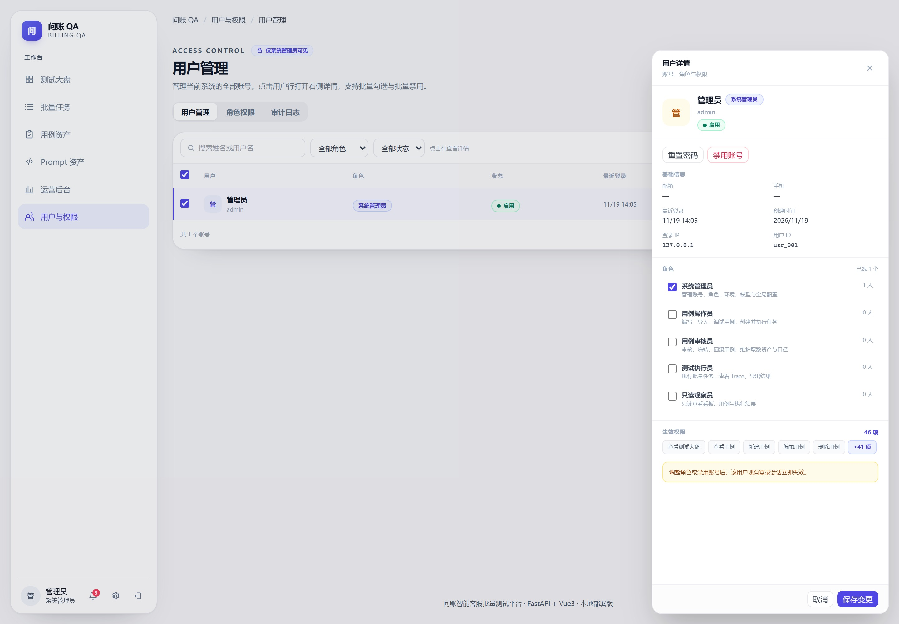
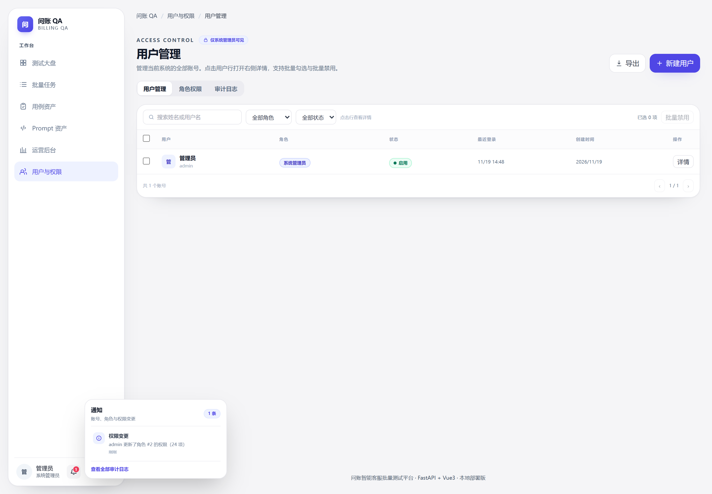
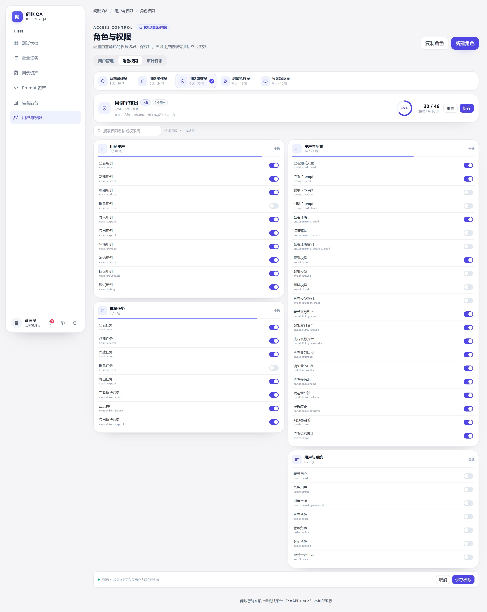
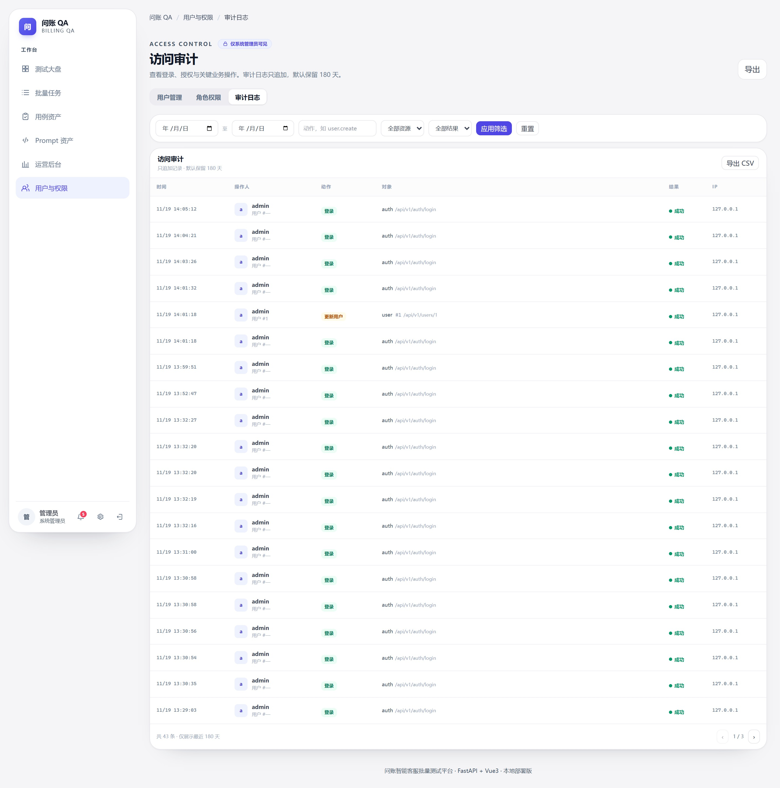

# 用户与权限管理系统 · 界面设计

> 可交互设计稿：[`docs/design/user-management/ui-design.html`](./design/user-management/ui-design.html)
>
> 在右侧预览窗打开后，可以点击顶部三个标签、左侧菜单、用户行和角色复选框查看交互状态；点击左下角铃铛展开通知面板。

---

## 0. 全局外壳

- 主侧边栏新增「用户与权限」入口，与「运营后台」等模块同级；仅 `SYSTEM_ADMIN` 可见。
- 右侧沿用主工作台框架：顶部面包屑，页面内提供「用户管理 / 角色权限 / 审计日志」三个标签。
- 不单独做一套「系统管理」外壳，也不再使用单图标窄侧边栏。
- 通知位于侧边栏**左下角**铃铛，点击展开面板；账号入口位于左下角用户卡片。
- 全局搜索下放到各页面内部（用户搜索、权限搜索、审计筛选），不新增右上角入口。

---

## 1. 用户管理

> 已采用方案 B「表格 + 侧滑抽屉」。两套方案的对比稿保留在：[用户管理 · 界面方案对比](./USER_MANAGEMENT_USER_DESIGNS.md)。

**布局：**

- 侧边栏：在主侧边栏新增「用户与权限」入口，与运营后台同级；只对 `SYSTEM_ADMIN` 渲染。
- 顶部：模块标题、说明、导出与「新建用户」主操作；标题旁标注「仅系统管理员可见」。
- 用户表格：搜索、角色筛选、状态筛选、批量勾选、批量禁用，保留用户/角色/状态/最近登录/创建时间。
- 右侧抽屉：点击用户行或「详情」按钮后从右侧滑出，展示基础信息、角色勾选、生效权限和保存操作。
- 左下角为全局通知入口，不占用表格或抽屉空间。

**关键交互：**

- 系统管理员可管理当前系统的全部账号，不按创建人过滤。
- 点击任意用户行打开右侧抽屉；点击关闭按钮、取消或按 Esc 收起。
- 勾选表格行会更新「已选 N 项」，支持批量禁用；抽屉内的行会同步勾选。
- 勾选/取消角色时，抽屉内权限摘要和「已选 N 个」同步变化。
- 重置密码、禁用账号、保存角色都会提示：该用户现有登录会话立即失效。
- 支持按姓名、用户名、角色和状态组合筛选。

### 入口可见性与管理范围

- 侧边栏入口：`v-if="auth.hasRole('SYSTEM_ADMIN')"`，非管理员不渲染。
- 路由守卫：`/system/**` 要求 `SYSTEM_ADMIN` 且具备 `user:read` / `role:read` / `audit:read`。
- 后端：`require_permission("user:read")` 等依赖仍是最终裁决；隐藏菜单不构成安全边界。
- 管理范围：系统管理员可操作当前系统的全部用户，包括创建、禁用、重置密码和分配角色；不存在“只能管理自己创建的用户”的限制。

### 左下角通知

- 铃铛固定在侧边栏底部，红色角标显示通知数量。
- 点击后在左下角展开统一通知面板，只展示账号创建、状态变更、角色调整、密码重置、权限变更等业务消息；登录/退出流水不进入通知。
- 点击铃铛再次收起；面板内提供「查看全部审计日志」入口。
- 账号头像和角色信息位于左侧底部用户卡片，与铃铛同一区域。

---

## 2. 角色权限

> 已采用方案 A「权限卡片」。三套方案的对比稿保留在：[角色与权限 · 界面方案对比](./USER_MANAGEMENT_ROLE_DESIGNS.md)。

**布局：**

- 顶部角色横向切换：内置角色、用户数、权限数；当前角色高亮。
- 角色摘要卡：角色名称、编码、说明、已授权进度环（18 / 30）、复制 / 重置 / 保存。
- 权限按模块拆成卡片：用例资产、批量任务、资产与配置、用户与系统。
- 每张卡片包含模块计数、完成度进度条和「全选」；单条权限展示中文名、权限码和边界说明。
- 窄屏下双列卡片自动变为单列，避免表格横向滚动。

**关键交互：**

- 点击角色切换权限卡片内容，进度环和模块计数同步更新。
- 开关切换权限，模块进度条实时变化；支持按权限名称或权限码搜索。
- 内置角色不可删除，支持复制；`SYSTEM_ADMIN` 的全量权限由代码保证。
- 保存权限时提示关联用户会话失效；权限码直接可见，方便开发、测试和审计对齐。

---

## 3. 审计日志

**布局：**

- 筛选区：时间范围、操作人、动作、结果。
- 审计表：时间、操作人及角色、动作标签、对象、结果；窄屏自动隐藏 IP 列。
- 动作使用颜色区分：角色变更 / 权限变更（靛蓝）、创建与审核（绿色）、禁用（琥珀）、登录失败（红色）。

**关键交互：**

- 支持按时间、操作人、动作、结果组合筛选。
- 结果列明确显示成功 / 失败，失败记录保留原因摘要。
- 审计日志只读、只追加，不提供编辑和删除入口。

---

## 4. 设计规范

| 项目 | 取值 |
| --- | --- |
| 画布背景 | `#f5f5f7` |
| 卡片 | 白色，圆角 18–20px，边框 `#e8e8ed` |
| 主色 | `#4f46e5`，浅底 `#eef2ff` |
| 成功 | `#059669` / `#ecfdf5` |
| 警告 | `#b45309` / `#fffbeb` |
| 危险 | `#e11d48` / `#fff1f2` |
| 正文字号 | 11–13px，标题 23px |
| 字体 | Inter / PingFang SC / Microsoft YaHei |
| 圆角 | 卡片 18px，控件 9–11px，标签 999px |

**响应式：**

- 全尺寸：使用主侧边栏，新增「用户与权限」入口，仅系统管理员可见。
- ≥ 780px：用户表格全宽，点击行后从右侧滑出抽屉；角色权限卡片双列。
- < 780px：抽屉宽度自适应并覆盖表格，表格隐藏次要列；角色权限卡片在 <620px 变为单列。
- 表格类页面在窄屏隐藏次要列，保留用户、角色、状态和结果等核心信息。

---

## 5. 对应前端路由

| 界面 | 路由 | 权限 |
| --- | --- | --- |
| 用户管理 | `/access/users` | `SYSTEM_ADMIN` + `user:read` |
| 角色权限 | `/access/roles` | `SYSTEM_ADMIN` + `role:read` |
| 审计日志 | `/access/audit` | `SYSTEM_ADMIN` + `audit:read` |

写操作按钮按 `user:write`、`role:write`、`role:assign`、`audit:read` 分别控制；后端仍需做最终鉴权。侧边栏入口只对 `SYSTEM_ADMIN` 渲染，其他角色即使直接输入 URL 也会被路由守卫和后端拒绝。
