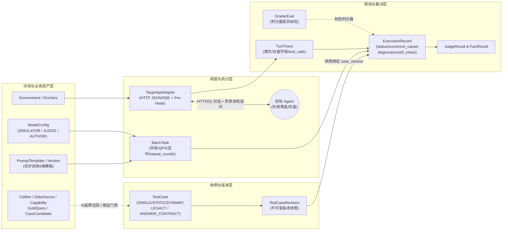
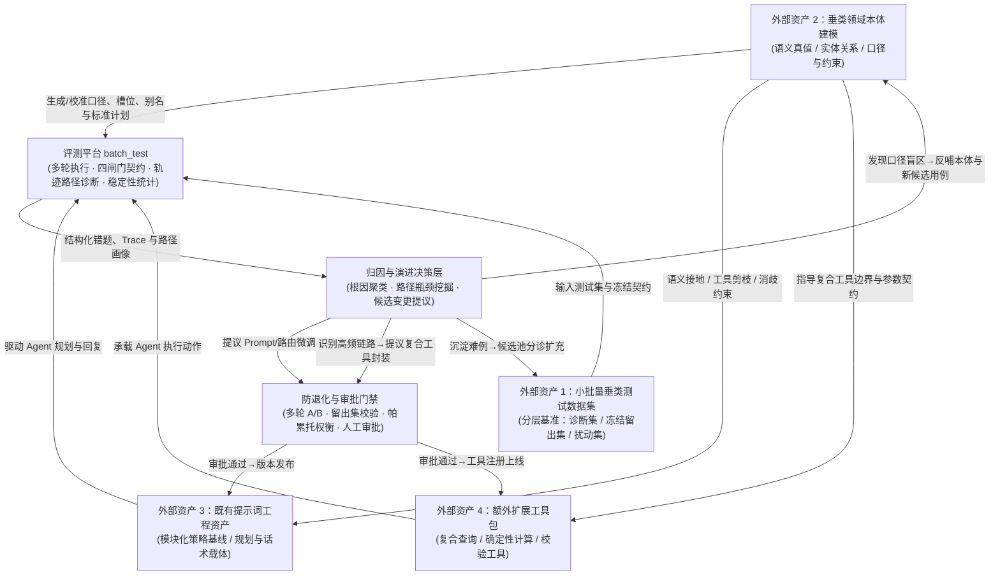
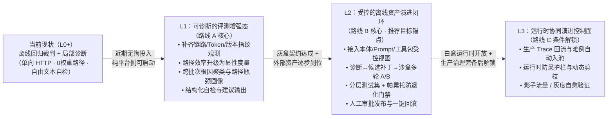

# 基于当前评测平台代码仓的“垂类 Agent 自演进”目标态方向调研报告

> **调研性质**：架构方向与目标态预研（Discovery & Target-State Research，非具体实现方案设计）  
> **勘探边界**：严格限于当前工作区评测平台代码仓（`batch_test`），只读分析；外部 4 类资产（小批量垂类测试数据集、领域本体建模、既有提示词工程资产、额外扩展工具包）与目标 Agent 本体当前不可访问，仅作为目标态中的已知输入要素类型纳入方向推演与接入前提分析。  
> **目标北极星**：探索以本评测平台为底座，向**垂类领域 Agent 自我演进优化体系**演进的可行方向，持续提升两项核心能力——**（1）问答准确率与运行稳定性**、**（2）最优调用路径与工具调用效率**。

---

## 一、调研结论速览（Executive Summary）

### 1.1 核心判断：底座远超“普通跑测工具”，但仍处于“单向裁判态”

经代码级深度测绘，`batch_test` 并非简单的问答脚本回归工具，而是一套面向高精度、强合规垂类问答场景（当前以电信计费问账为演示域，底层通过环境模板解耦业务域）建成的**契约驱动、证据可审计的评测平台**。仓库中已经沉淀出若干极高价值的“自演进基因”：

- **低噪确定性信号源**：除 `LEGACY`（规则硬校验 + 多 LLM 裁判）外，已实现 `ANSWER_CONTRACT`（安全 / 行为 / 事实 / 扩展四道确定性闸门 + 名称-数值绑定），能够提供可复现、抗话术欺骗的优化信号；
- **路径诊断雏形**：已具备 `plan_spec` 声明、`tool_calls` 提取、0 权重轨迹诊断（重复查询、超预算、缺能力、意外能力、`lucky_pass` 侥幸通过）及 5 类根因自动分类；
- **对话内自检雏形**：已实现失败追问自检（`run_self_check`），可在评测判失败后于同一会话内将裁判理由与预期口径回喂给目标 Agent 要求其自查；
- **稳定性与防退化基建**：已支持连续多轮执行（`repeat_rounds`）、跨轮稳定性与 Flaky/回归分析报表、草稿隔离沙盒（`SANDBOX`）、用例版本快照绑定、判分器变异自检（`GraderEval`）及候选池转正机制。

然而，从架构本质看，**当前平台仍是一个“单向 HTTP 观测 + 离线裁决系统”**：它只能通过 HTTP(S) 接口调用目标 Agent 并读取响应，没有面向目标 Agent 资产（Prompt、路由策略、本体规则、工具编排）的版本映射、归因聚类、候选补丁实验与受控发布闭环；且在观测层与度量层仍存在若干影响“路径优化”和“跨版本归因”的实证断层。

### 1.2 推荐的目标态战略姿态：以 L2 为主锚点，采取“L1 夯实诊断 → L2 离线受控闭环 → L3 条件解锁运行时协同”阶梯

在**小批量测试集**与**外部资产/目标 Agent 内部形态尚未明晰**的约束下，**切忌一步跨入“全自动在线自修改”或提前锁定某套固定优化算法**。最具“进可攻、退可守”价值的演进策略是：

1. **优先建设 L1（结构化诊断与路径评估增强态）**：纯评测侧可独立推进、对目标 Agent 零改造依赖，先把观测盲区、路径效率度量、跨用例失败聚类与 Agent 版本指纹补齐；
2. **核心押注 L2（受控的离线资产演进闭环）**：将平台升级为“评测裁判 + 归因引擎 + 离线资产迭代与门禁验证编排器”。围绕**领域本体、模块化提示词、扩展工具包、小批量分层测试集**四类外部资产，形成“评测发现缺陷 → 结构化归因 → 生成候选变更（Prompt / 路由 / 本体口径 / 复合工具建议）→ 多轮防退化 A/B 验证 → 人工审批发布”的半自动闭环；
3. **条件解锁 L3（运行时深度协同演进控制面）**：仅当 L2 闭环验证有效、目标 Agent 开放灰/白盒配置热更新与运行时护栏钩子、且具备生产日志回流通道后，再审慎向运行时协同演进。

### 1.3 关键速览：优势、最大鸿沟与 Top 5 决策分叉

| 维度 | 核心摘要 |
| --- | --- |
| **本仓最大既有优势** | 确定性四闸门答案契约 + 名称-数值绑定；`tool_calls` 提取与 `lucky_pass`/根因诊断；同会话失败追问自检；连续多轮执行与 Flaky/回归分析；`Capability`/`GoldQuery`/`Caliber` 业务资产体系；`SANDBOX` 沙盒隔离与 `GraderEval` 判分器自检。 |
| **最值得优先押注的方向** | **L2 离线受控资产演进闭环**：以领域本体为语义真值底座、以模块化提示词与扩展工具包为双执行杠杆、以多轮分层测试集与双目标帕累托门禁（准确率 × 路径效率）防小样本过拟合。 |
| **现状到目标态最大鸿沟** | ① **缺少“目标 Agent 版本/配置指纹 + 实验（Experiment）”一等抽象**，无法将评测指标波动精确归因到 Agent 侧哪类变更；② **反馈闭环断裂在单条自由文本自检**，无跨批次根因聚类、候选优化提议与受控回归门禁；③ **路径最优性仍为 0 权重附带诊断**，且存在流式帧截断、未采 Agent Token、未联动执行器日志等观测缺口。 |
| **Top 5 待拍板决策问题** | ① 目标 Agent 的可观测与可干预边界（黑盒/灰盒/白盒）；② 领域本体建模的真实形态与权威维护方；③ 既有提示词与扩展工具包的模块化/可接入程度；④ 小批量测试集的量级、分层策略与数据快照可复现性；⑤ 准确率与路径效率的业务权衡红线及人类审批边界。 |

---

## 二、代码仓现状实证测绘（As-Is Capability Mapping）

> 本节所有结论均基于对工作区内真实代码与文档的静态核查，标注精确文件路径与核心符号。

### 2.1 平台当前核心抽象、生命周期覆盖与领域实体关系

平台采用 `FastAPI + SQLAlchemy 2.0 Async + PostgreSQL + Redis` 后端（`backend/billing_qa/`）与 `Vue 3 + TypeScript + Pinia + ECharts` 前端（`frontend/src/`），共沉淀 **22 张 ORM 表**（18 张业务表 + 4 张 RBAC/审计表）及 **11 个前端主功能视图**（`frontend/src/router.ts`）。

当前完整覆盖的评测生命周期包含 **5 个闭环内环节**（均围绕“测试资产与离线回归”，尚未延伸至目标 Agent 侧变更）：

1. **接入与资产准备**：
   - 被测环境抽象：`Environment` / `EnvironmentVariable`（`backend/billing_qa/models/environment.py`），支持 HTTP(S) JSON / SSE、Jinja2 请求模板（`services/templating/`）、Basic Auth / mTLS / Pre-Hook 多字段提取、`SERVER_RETURNED` 与 `CLIENT_GENERATED` 两种会话绑定模式，以及报文预览与探活调试（`POST /environments/{id}/preview`、`debug-chat`）。
   - 评测侧模型与 Prompt 资产：`ModelConfig`（`models/model_config.py`）支持 `OPENAI_COMPATIBLE` 与 `OPENCODE_SERVE` 双接入协议（`services/llm/client.py:LLMClient`），按 `SIMULATOR` / `JUDGE` / `CASE_AUTHOR` 三类角色注册；`PromptTemplate` / `PromptTemplateVersion`（`models/prompt_template.py`、`api/v1/prompts.py`）管理 `USER_SIMULATOR` / `LLM_JUDGE` / `CASE_AUTHOR` / `SELF_CHECK` 四类**评测侧**模板，支持 `LATEST`/`PINNED` 引用策略、影响面分析与在线沙盒。
   - 领域与取证资产：`Caliber`（业务口径字典，`models/candidate.py`）、`DataSource` / `Capability`（取数通道与参数化查询模板，`models/capability.py`）、`GoldQuery`（取证快照，`models/gold_query.py`）、`CaseCandidate`（生产日志/轨迹/手工候选池，`models/candidate.py`、`api/v1/candidates.py`）。
2. **用例生产与数据集门禁**：
   - `TestCase` / `TestCaseRevision`（`models/test_case.py`）支持单轮（`SINGLE`）、静态多轮（`STATIC_MULTI`）、动态多轮（`DYNAMIC_MULTI`，含 `user_goal`/`hidden_context` 挤牙膏释放/`terminate_conditions`）；
   - AI 辅助起草：`services/author/service.py` 召回 `Caliber`、`Capability` 与相似历史用例生成草稿，并对金额/日期强制做文本依据核验，无依据项写入 `missing`；
   - 评审与冻结闸门：`services/facts.py`（`ensure_review_gate`、`assert_must_facts_verified`）强制要求 `ANSWER_CONTRACT` 用例的所有 Must 事实经 `VERIFIED`/`WAIVED` 取证后方可审批通过并冻结至指定 `dataset_version`。
3. **批量调度与对话执行**：
   - `BatchTask`（`models/task.py`）与 `BatchScheduler`（`services/engine/scheduler.py`）提供任务级并发信号量（1–20）、令牌桶 QPS 限流、异常分类自动重试（`services/engine/error_policy.py`：仅对 `ENV`/`LLM` 重试，不对 `BUSINESS` 重试）、终止/断点续做（`RESUME`）/失败重跑（`RETRY`）/单用例重试队列、定时计划（`IMMEDIATE`/`SCHEDULED`/`DAILY`/`WEEKLY`）、连续多轮链式执行（`repeat_rounds` + `_start_next_round`）及基于 Redis 锁的重启自愈；
   - `CaseExecutor`（`services/engine/executor.py`）负责执行前冻结用例快照、驱动单轮/静态多轮/动态多轮状态机，并施加三重熔断（`MAX_TURNS_EXCEEDED`、`REPETITION_ABORT`、`GIVE_UP`）。
4. **双轨判分与失败追问自检**：
   - `LEGACY` 模式：`services/engine/rule_evaluator.py`（金额/笔数/日期/包含/禁用硬校验）与 `services/engine/judge.py`（多裁判并行 `AVG`/`VETO` + 数据准确性 0 分等 4 条红线）取交集；
   - `ANSWER_CONTRACT` 模式：`services/grading/answer_grader.py:grade_answer` 执行 `safety`、`behavior`、`facts`、`extras` 四道确定性闸门（`envelope.py`、`behavior.py`、`name_binding.py`），LLM 仅保守用于 claim 抽取补充、降级文本语义放行及跑题复核，另附跑 `LEGACY` 裁判作为参考质量分；
   - 失败追问自检：`services/engine/self_check.py:run_self_check` 在判失败后于同一会话追加一轮追问，结果写入 `ExecutionRecord.self_check`，不影响原裁决。
5. **观测分析、导出与沙盒调试**：
   - 执行指标与统计：`services/engine/metrics.py`、`api/v1/stats.py`（`stats_overview`/`fact_stats`/`dataset_stats`）、`api/v1/cases.py`（`case_trend` 趋势与 `flaky` 判定、`compare_runs` 双次执行字段级对比）；
   - 报表与机读导出：`services/io/execution_jsonl.py`（无截断 JSONL 导出）、`services/io/multi_round_report.py`（6 页跨轮稳定性/环比/回归/风险用例 Excel 及 JSONL）；
   - 交互式视图：`CaseTraceInspector.vue`、`ChainList.vue`、`SelfCheckPanel.vue`、`RunComparePanel.vue`、`CaseTrendPanel.vue`、`CaseDebugWorkbench.vue`（草稿试跑记 `source=SANDBOX`，自动排除出统计口径）及 `OpsView.vue`（7 大运营页签）。

### 2.2 调用链路与 I/O 可观测粒度实证盘点

平台通过 `services/adapter/extractor.py` 与 `extraction.py`（支持字符串 JSONPath 及 `if/elif/else` 条件规则、`occurrence=last`、跨级 `take_join`、SSE `_frames` 帧序保留）从目标 Agent 响应中抽取白盒信息，映射至 `TargetResponse`（`services/adapter/target_api.py:42-58`）并落库到 `TurnTrace` 与 `ExecutionRecord`（`models/execution.py`）。

| 观测维度 | 平台当前落库/承载位置 | 结构化程度 | 实证说明与盲区（基于代码核查） |
| --- | --- | --- | --- |
| **请求/响应原始报文** | `TurnTrace.request_payload` / `response_raw` | 半结构化 JSON | 完整记录方法、URL、脱敏头、请求体、响应体及条件提取命中轨迹 `extraction`；**盲区**：SSE 流解析上限 `MAX_FRAMES = 300`（`sse.py:13`），但 `target_api.py:430` 落库时仅保留 `sse_result.frames[-50:]`，长链路多步流式场景可能丢失前序规划/调用帧。 |
| **每轮对话与会话连续性** | `TurnTrace.query` / `final_answer` / `session_id` / `simulator_thought` / `hidden_context_released` | 已结构化 | 完整记录动态多轮模拟器思考、状态、隐藏信息释放及会话连续性；前端 `case-trace/model.ts` 自动检测 `consistentSession`。 |
| **Agent 内部白盒槽位** | `TurnTrace.intent` / `generated_sql` / `api_params` / `raw_db_data` | 已结构化（依赖目标接口吐出） | 全部通过环境级 `extractors` 映射提取；若真实目标 Agent 响应体不吐出这些字段，则均为空值。 |
| **工具调用链路 (`tool_calls`)** | `TurnTrace.tool_calls` + `ExecutionRecord.diagnostics` | 已结构化（依赖目标接口吐出） | `diagnostics.py:build_diagnostics` 已结构化统计调用次数、按 `kind`/`status` 分布、`capabilities_used`、`missing_capabilities`、`unexpected_capabilities`、`over_budget`、`repeated_queries`、`tool_errors`、`evidence_rows`；前端 `ChainList.vue` 支持按 5 阶段分组折叠与慢步骤/异常筛选。**盲区**：① `CypherToolExecutor.logs()`（`cypher_tool.py:119`）虽已实现按 `session_id` 拉取外部工具日志，但未在 `CaseExecutor` 中调用以补全黑盒 Agent 轨迹；② `PlanSpec.alternatives` 与 `allow_parallel`（`schemas/case.py:215-217`）在 `diagnostics.py` 中未消费。 |
| **事实-证据绑定账本** | `TurnTrace.evidence`、`FactResult` | **部分未贯通** | `FactResult` 完整记录事实级期望/实际/通过/原因/证据引用；但 `TurnTrace.evidence` 列（`models/execution.py:139`）在 `CaseExecutor._build_record`（`executor.py:809-835`）中**从未赋值**；此外 `answer_grader.py:52` 先于 `extract_claims`（第 72 行）调用 `build_diagnostics`，未传入 `numeric_claim_count`，导致 `no_tool_call_but_claims` 与 `evidence_gap` 恒为 `False`。 |
| **性能与成本遥测** | `TurnTrace.ttft_ms` / `latency_ms`；`ExecutionRecord.simulator_tokens` / `judge_tokens` | **评测侧完整，Agent 侧缺失** | 评测侧 TTFT、总时延、模拟器与裁判 Token 完整；但**目标 Agent 自身的 Token 消耗、内部 LLM 调用次数、单步推理耗时**无落库列（`frontend/src/views/components/case-trace/model.ts:153-160` 明确注释真实库中 `agentTokens` 为 `null`）。 |
| **推理过程 / 路由决策 / 检索召回** | 无独立字段（仅可能散落于 `response_raw`） | 原始文本 / 未观测 | 平台无法直接观测目标 Agent 的 System Prompt 组装、知识检索 Top-K 召回片段、工具候选排序置信度、规划树回溯等内部过程。 |
| **失败归因与自检结论** | `ExecutionRecord.root_cause`、`JudgeResult.reason`/`error_tags`、`ExecutionRecord.self_check` | 混合（标签结构化，归因与自检为自由文本） | `root_cause` 仅 5 个粗粒度枚举（`RETRIEVAL`/`SYNTHESIS`/`HALLUCINATION`/`BEHAVIOR`/`UNKNOWN`）；`self_check.conclusion` 为自由文本且未向 Agent 注入 `tool_calls`/`diagnostics`（`self_check.py:221-284`），也无跨执行聚合消费。 |

### 2.3 仓库已有“演进基因”盘点

从向“垂类 Agent 自演进”升级的视角看，本仓库已具备 **8 项高复用价值的架构基因**：

1. **基因一：确定性答案契约与名称-数值绑定（`services/grading/answer_grader.py`, `envelope.py`, `behavior.py`, `name_binding.py`）**  
   将垂类高风险问答的正确性从“LLM 裁判主观感觉”收束为四道可复现的代码闸门，并能捕获“张冠李戴（`name_conflict`）”与“静默假设（`behavior=False`）”。这是自演进体系最稀缺的**低方差、抗欺骗奖励信号（Verifier）**。
2. **基因二：路径诊断与 `lucky_pass` 识别（`services/grading/diagnostics.py`, `schemas/case.py:PlanSpec`）**  
   已初步建立“结果正确 ≠ 路径有效”的工程认知，能够识别无取数凭空蒙对（`lucky_pass`）、重复查询（`repeated_queries`）、能力遗漏/越界与步数超预算（`over_budget`），为“最优调用路径优化”提供了直接的数据基础。
3. **基因三：同会话失败追问自检（`services/engine/self_check.py`, `db/seed.py:SELF_CHECK_DEFAULT_CONTENT`）**  
   在评测失败后即时向目标 Agent 回传裁决依据与预期口径并触发反思——这本质上是 **Reflexion / 执行后反思（Post-hoc Reflection）机制的工程原型**，只需进一步结构化即可沉淀为离线优化的归因素材。
4. **基因四：连续多轮执行与 Flaky/回归统计体系（`models/task.py:repeat_rounds`, `services/engine/scheduler.py:_start_next_round`, `services/io/multi_round_report.py`, `api/v1/cases.py:case_trend`/`compare_runs`）**  
   天然支持对同一批用例连续跑多轮，并输出“稳定失败 / 波动 Flaky / 压线通过 / 回归 / 恢复”分类与环比趋势，是**应对小样本随机方差与“改好 A 改坏 B”退化的现成基础设施**。
5. **基因五：业务口径、取数能力与取证账本（`Caliber`, `DataSource`, `Capability`, `GoldQuery`, `services/facts.py`）**  
   已经把“业务口径裁定”“参数化取数能力”“权威真值取证”抽象为一等公民，天然构成外部**领域本体建模**与**扩展工具包**在评测侧的语义停靠点。
6. **基因六：草稿沙盒与不可变版本快照（`ExecutionSource.SANDBOX`, `CaseDebugWorkbench.vue`, `TestCaseRevision`, `PromptTemplateVersion`）**  
   支持零污染试跑（自动剔除统计口径）与版本级精确复现/Diff/回滚，为自演进中的“候选策略沙盒验证”提供了成熟的隔离范式。
7. **基因七：判分器变异自检（`GraderEval`, `services/grading/mutants.py`, `api/v1/grader.py`）**  
   具备“评测裁判自身质量”的元验证机制（检测漏杀与误杀），可防止自演进过程中裁判失真或被优化器钻空子。
8. **基因八：证据受控的 AI 起草与候选池转正（`services/author/service.py`, `CaseCandidate`, `api/v1/candidates.py`）**  
   已实现“生产日志/失败轨迹 → 候选池去重分诊 → AI 基于口径/能力/历史用例起草（禁编造数值）→ 审核转正”的数据集增长通道，可直接服务于自演进中的**难例反哺与测试集动态扩充**。

### 2.4 固有架构约束识别

1. **强黑盒 HTTP 边界与单向控制面约束**：  
   `TargetApiAdapter`（`services/adapter/target_api.py`）仅通过 HTTP(S) 调用被测对话接口，平台对目标 Agent 的 Prompt、路由配置、知识库、工具注册表均无写权限与版本感知能力。`ExecutionRecord` 仅绑定 `environment_id` 与 `case_version`，**缺乏目标 Agent 自身的版本/配置快照标识**（例如 `agent_revision` / `config_fingerprint`），导致同一环境下多次运行对比时难以程序化区分“Agent 变更导致的提升”与“模型波动或环境数据变化”。
2. **评测成本与耗时放大约束**：  
   动态多轮模拟（`SIMULATOR`）+ 多裁判并行（`JUDGE`）+ 失败自检（`SELF_CHECK`）+ 连续多轮（`repeat_rounds`）会成倍放大 LLM 与目标 Agent 调用开销；且代码实证显示 `CaseExecutor._complete_contract`（`executor.py:578-595`）在契约模式下仍默认附跑一次全量 `LEGACY` 裁判生成参考质量分，增加了高频迭代验证的边际成本。
3. **进程内调度与单租户隔离约束**：  
   `BatchScheduler`（`scheduler.py`）采用进程内 `asyncio` 调度（单任务并发上限 20，依赖 Redis 锁防多实例重跑），且 RBAC 为单租户共享数据视图（`README.md` §13）。若未来演化出高并发候选策略搜索（如同时评估数十组候选 Prompt/路由变体），进程内调度与环境并发配额将成为瓶颈。
4. **外部数据快照非强约束风险**：  
   `TestCase.as_of` 与 `snapshot_id` 当前仅作元数据落库展示（`docs/ANSWER_CONTRACT_OPERATIONS.md` §9.3、`docs/EXTERNAL_INTEGRATION_QUESTIONS.md` EXT-04），平台无法强制目标 Agent 底层业务库锁定时间点。一旦实时业务数据漂移，历史基线与新迭代结果将失去严格可比性。
5. **取数通道与判分规则的扩展性约束**：  
   `services/capability/factory.py:build_executor` 目前仅实现 `CYPHER_TOOL`（`SQL_DB`/`HTTP_API` 仅定义枚举未实现执行器）；`services/grading/behavior.py` 依赖固定中文关键词表与 5 个写死的澄清槽位同义词表（`time_range`/`focus`/`customer`/`object`/`caliber`），`services/grading/prompts.py` 亦硬编码于 Python 源码中，跨垂类扩展或精细调优需改代码发版。
6. **轮次级评测与路径归因粒度约束**：  
   `ANSWER_CONTRACT` 仅针对最后一轮回复判分（`answer_grader.py:176`），`LEGACY` 裁判同样按整通会话给分且 `build_judge_variables`（`judge.py:92-117`）只喂入 `raw_db_data` 而未喂入 `tool_calls`/`generated_sql`。在多轮复杂问账或长工具链中，无法直接定位“具体是哪一轮的哪一步调用”引发了最终错误。

---

## 三、目标态核心命题与多方向探索（Target-State Directions）

> 本节不预先锁定单一落地方案，而是围绕目标态的 5 个核心架构命题，客观展开可行方向谱系、适用前提与取舍权衡。

### 3.1 平台在目标态中的角色定位演进

基于本仓库现状，评测平台向“垂类 Agent 自演进体系”过渡存在 **4 种递进式角色定位**：

| 角色形态 | 核心职责边界 | 与目标 Agent 的耦合度 | 典型输出物 | 适用阶段与前提 |
| --- | --- | --- | --- | --- |
| **形态 1：智能诊断顾问** （Diagnostic Advisor） | 仍作为外部离线评测器，但从“报分数”升级为“跨批次聚类归因 + 路径瓶颈画像 + 优化建议清单”。 | **纯黑盒 / 轻灰盒** （仅读 HTTP 响应与可选白盒字段） | 失败聚类报告、高频冗余路径榜单、定向人工整改建议 | 目标 Agent 完全不可控、团队尚处于摸底期。 |
| **形态 2：离线资产演进编排器** （Offline Asset Evolution Orchestrator） | 平台托管或关联 Agent 的可版本化外围资产（Prompt、Few-shot、本体口径视图、工具描述/路由规则），离线驱动“诊断 → 生成候选变更 → 沙盒多轮 A/B 回归 → 人工审批发布”。 | **灰盒契约耦合** （通过配置仓库/参数接口/双环境对比验证，不改 Agent 内核代码） | 带回归证据链的候选资产 PR/版本包、帕累托对比报告 | 存在可配置资产面、小批量高价值数据集、要求变更可审计与可控发布。 |
| **形态 3：双侧协同进化中枢** （Gray-Box Co-Evolution Hub） | 除离线资产优化外，评测侧将验证通过的“最优调用模式、避坑经验、高频复合工具抽象、本体口径校验规则”双向沉淀为 Agent 侧可消费的技能包/记忆库/护栏配置。 | **深度灰盒 / 轻白盒** （双方约定标准化 Telemetry 与 Skill/Policy 交换契约） | 标准化的经验/路由策略包、复合工具需求与验证套件、本体同步包 | 评测团队与 Agent 研发团队深度协同、工具链与本体资产可双向联动。 |
| **形态 4：运行时演进控制面** （Runtime Self-Evolution Control Plane） | 直接接入 Agent 运行时：实时采集线上全量 Trace、执行在线防呆护栏/动态路由、基于线上隐式反馈触发影子流量（Shadow）与灰度自愈。 | **强白盒耦合** （深度嵌入 Agent 脚手架与生产网关） | 在线路由决策、运行时护栏策略、自动化灰度切换 | 业务流量大、Agent 架构高度标准化、线上可观测与回滚体系极其完备。 |

**架构洞察**：当前 `batch_test` 的核心资产（契约判分、多轮稳定性、沙盒、版本快照、运营后台）与**形态 2（离线资产演进编排器）**和**形态 3（双侧协同进化中枢）**契合度最高；而形态 4 需要完全不同的运行时低延迟基础设施，不应在缺乏离线闭环验证能力前盲目推进。

### 3.2 面向“问答准确率提升”的演进方向谱系

在不依赖（或不强依赖）基座模型权重微调的前提下，结合垂类领域本体、既有提示词与小批量测试集，提升问答准确率存在 **5 条本质不同的优化方向**，各自对应不同的错误根因：

1. **方向 A1：提示词与交互协议的结构化演进（Modular Prompt & Policy Evolution）**  
   - **本质**：将既有“大一统”提示词拆解为职责正交的模块（角色与合规红线、歧义处理与反问协议、口径声明规范、输出结构契约），基于失败样本的归因反馈进行局部定向修订与多版本 A/B 优选（而非黑盒整段重写）。
   - **擅长解决**：非清晰输入行为越界（静默假设、边问边答、拒答不当）、输出格式不规范、多轮追问时的指代丢失与状态遗忘。
   - **局限性**：无法凭空补足缺失的底层业务事实或修复错误的数据查询逻辑；过度堆砌规则易触发指令冲突与上下文稀释。

2. **方向 A2：领域本体驱动的语义接地与口径注入（Ontology-Grounded Semantic Alignment）**  
   - **本质**：以垂类领域本体建模作为语义真值源（实体定义、属性层级、概念同义词、指标计算口径、时间窗口规则、约束边界），在意图解析、槽位澄清与回答校验环节按需注入结构化本体切片，替代分散在 Prompt 里的零散口头约定。
   - **擅长解决**：垂类专有术语误解、口径偏差（如含税/不含税、自然月/出账月、赠费与可用余额区分）、相似实体混淆及“缺少关键槽位却不知该问什么”的问题。
   - **局限性**：强依赖领域本体的准确性、完备度与持续维护；若本体本身过时，会系统性放大错误。

3. **方向 A3：检索与查询构造精准化（Query Grounding & Schema-Guided Retrieval）**  
   - **本质**：针对 `RETRIEVAL` 类根因，优化“自然语言问题 → Cypher/SQL/API 调用参数”的翻译过程，例如：基于本体裁剪无关 Schema 噪声、沉淀经 `GoldQuery` 验证的高精度查询模板/Few-shot 示例、引入参数类型与必填槽位前置校验。
   - **擅长解决**：查错表/实体、漏加时间/租户过滤条件、参数格式错误、空结果误判或查询语法异常导致的事实缺失。
   - **局限性**：依赖目标 Agent 暴露查询语句与入参（灰盒可观测）或允许优化其查询生成模块。

4. **方向 A4：推演与合成解耦——计算与校验向确定性工具卸载（Neuro-Symbolic Offloading）**  
   - **本质**：针对 `SYNTHESIS` 与 `HALLUCINATION` 类根因（查到了正确数据但算错、抄错、张冠李戴或编造扩展），将数值汇总、占比计算、账期对比、名称-数值一致性核对从 LLM 自由文本生成中剥离，交由扩展工具包中的确定性代码或后置自检节点完成。
   - **擅长解决**：精确数值算术偏差、多条明细汇总遗漏、高风险合规场景下的数值张冠李戴与无据编造。
   - **局限性**：需要扩展工具包支持或 Agent 侧支持“取数 → 确定性加工 → 文本表述”的编排模式。

5. **方向 A5：失败案例驱动的对比式经验记忆（Failure-Driven Episodic Memory / Few-Shot Bank）**  
   - **本质**：将评测中反复踩坑的高价值失败案例（经脱敏与抽象后的“易错问法 + 正确思路/口径 + 典型陷阱”）沉淀为结构化经验库，在相似问题到来时动态召回作为参考上下文。
   - **擅长解决**：长尾边界场景、隐蔽业务特例、高频易混问法的快速纠偏。
   - **局限性**：在小批量测试集下**过拟合风险极高**——若直接按原题召回，测试集分数虚高但泛化能力反而退化，必须配合抽象泛化与严格留出集（Holdout）检验。

#### 错误类型 × 准确率优化方向适配矩阵

| 典型错误类型（对应平台信号） | A1 模块化 Prompt 演进 | A2 本体语义接地 | A3 查询/取数精准化 | A4 计算/校验卸载 | A5 经验记忆纠偏 |
| --- | :---: | :---: | :---: | :---: | :---: |
| **知识口径缺失/歧义**（`口径遗漏` / `CALIBER_CONFLICT`） | 弱 | **强（核心）** | 中 | 弱 | 中 |
| **非清晰输入越界/静默假设**（`behavior=False` / `BEHAVIOR`） | **强（核心）** | **强（槽位定义）** | 弱 | 中（前置槽位校验） | 中 |
| **取数查错/漏查/参数错**（`RETRIEVAL` / `tool_errors` / `missing_capabilities`） | 中 | **强（实体/关系约束）** | **强（核心）** | 中 | 中 |
| **数据查对但算错/张冠李戴**（`SYNTHESIS` / `name_conflict`） | 中 | 中（别名映射） | 弱 | **强（核心）** | 弱 |
| **无据编造/幻觉**（`HALLUCINATION` / `extras=False` / `lucky_pass`） | 中（拒答规范） | 中 | 中 | **强（证据强绑定）** | 弱 |
| **多轮上下文退化/复读熔断**（`MAX_TURNS` / `REPETITION_ABORT`） | **强（对话状态协议）** | 中（槽位状态机） | 弱 | 中 | 弱 |

### 3.3 面向“最优调用路径优化”的演进方向谱系

垂类 Agent 的“最优调用路径”并非单纯追求“步骤越少越好”（否则会诱发不查数瞎猜的 `lucky_pass`），而是**在满足事实完备与证据可审计的前提下，最小化无效试探、错误重试、重复查询、无关工具调用与总时延/Token 开销**。路径优化可分为 **4 个不同层次**，在评测侧与 Agent 侧各有发力重心：

| 优化层次 | 核心机理 | 评测侧职责（`batch_test` 延伸） | Agent 侧职责（目标系统 / 工具层） | 对路径指标的改善形态 |
| --- | --- | --- | --- | --- |
| **层次 1：事前约束与动作空间剪枝** （Pre-Execution Pruning） | 在 Agent 规划前缩小候选工具与参数空间：依据领域本体将用户意图映射到高相关能力子集、收紧工具描述歧义、明确必填入参前置条件（缺参先澄清而非盲调报错）。 | 基于历史轨迹统计“误选工具矩阵”“缺参盲调失败率”，维护标准能力清单与 `PlanSpec` 基准。 | 按意图/本体动态裁剪暴露给 LLM 的工具子集（Tool Scoping）；在 Tool Schema 层强化参数描述与枚举约束。 | 显著减少 `unexpected_capabilities`、参数错误重试与无效探测步数。 |
| **层次 2：事后轨迹反思与最优路径归纳** （Post-Hoc Trajectory Distillation） | 离线对比同一任务/同类意图的“成功最短路径”与“冗余/失败路径”，利用轨迹挖掘与结构化反思提炼“标准取数配方（Golden Plan）”与“反模式警示”，回注到规划 Prompt 或路由示例。 | 升级轨迹分析引擎：自动聚合 `tool_calls` 序列模式、识别高频冗余环路与慢步骤，产出结构化路径优化建议与规划 Few-shot 候选。 | 消费版本化的规划策略/Few-shot 路由示例，指导多步 Planner 优先选择经验证的高效调用序列。 | 降低平均调用步数、消除多轮弯路与次优替代工具选择。 |
| **层次 3：高频链路能力沉淀与工具抽象** （Skill / Macro-Tool Crystallization） | 当评测轨迹持续暴露出固定组合的多步串行调用（如“先查客户ID → 再查当期账单 → 再拉费用明细并聚合”）时，将其下沉封装为扩展工具包中的**高阶复合能力/确定性技能**，把不稳定的 LLM 多步推理转化为单步确定性执行。 | 通过轨迹序列频繁项挖掘（Frequent Subsequence / N-gram）发现高价值封装候选，并自动生成对应回归验证用例。 | 在扩展工具包中实现复合能力、并发扇出或批量查询接口，并在工具注册表中替代/收敛底层碎片化原子调用。 | **路径效率上限最高**：步数、TTFT/总时延与中间合成错误率同步大幅下降。 |
| **层次 4：运行时防呆护栏与预算控制** （Runtime Guardrails & Budget Control） | 在 Agent 执行循环中嵌入轻量确定性保护：会话内相同 `(tool, params)` 查询结果缓存去重、只读/权限前置拦截、超步数预算提前熔断或降级为向用户澄清。 | 提供预算超限（`over_budget`）、重复查询（`repeated_queries`）与异常注入压力测试集，验收护栏生效且不误伤正常链路。 | 在 Agent 工具执行器/编排框架内实现调用去重缓存、参数预检与步数预算策略。 | 彻底消除死循环、重复查库与失控 Token 消耗，兜底运行稳定性。 |

### 3.4 外部 4 类资产在目标态中的价值定位与协同关系

由于 4 类外部资产当前不可访问，以下分析不预设其具体文件格式，而是从系统架构层面厘清它们的**不可替代角色**与**飞轮协同关系**：

1. **小批量垂类测试数据集（Small-Batch Vertical Testset）—— 系统的“北极星标尺与防线”**  
   - **定位**：绝不能当作传统机器学习的“海量训练集”去盲目拟合，而应定位为**高信噪比业务契约基准（Anchor）与回归防线（Sentinel）**。
   - **关键用法**：必须进行逻辑分层（如：用于暴露问题与归因的**诊断工作集**、严禁参与任何优化提示生成的**冻结留出验证集**、以及通过同义改写/槽位扰动衍生的**泛化压力集**）。
2. **垂类领域本体建模（Domain Ontology Modeling）—— 双侧共享的“语义单一真值源（SSOT）”**  
   - **定位**：连接业务知识、评测标准与 Agent 认知的骨架。它定义实体、关系、指标口径、约束与可查询路径。
   - **双向赋能**：向**评测侧**，它为 `Caliber`、`AnswerEnvelope`（同义词/别名/容差）、`ResponseContract`（必问槽位）和 `PlanSpec`（合法能力组合）提供权威来源；向**Agent 侧**，它为意图消歧、工具剪枝与口径遵循提供结构化接地。
3. **既有提示词工程资产（Existing Prompt Engineering Assets）—— 可演进的“策略基线与行为载体”**  
   - **定位**：承载了业务团队已积累的大量隐性经验与边界约束，是自演进的**初始基线（v0）与主要软调优载体**。
   - **演进前提**：需从“隐式经验文本”转化为“可版本化、可模块化拆解、可归因追踪”的受控资产，避免演进时因全量覆写丢失历史血泪经验。
4. **额外扩展工具包（Extended Toolkit）—— 拓展上限的“动作空间与确定性杠杆”**  
   - **定位**：解决纯 Prompt 与纯语言推理无法跨越的硬上限（精确计算、复合查询、结构化校验、本体实时查询）。
   - **双向制约**：工具不是越多越好——无治理地向 Agent 倾倒扩展工具会扩大选择熵、恶化调用路径；必须由评测侧的失败根因与高频冗余路径数据**需求拉动**工具的增删与抽象。

#### 四类外部资产与评测平台的正向演进飞轮

**孤立使用的反面警示**：若 4 类资产各自孤立——只有 Prompt 优化没有本体，系统会不断用冗长补丁打补丁且口径互相打架；只有扩展工具没有路径评测，工具越多 Agent 越容易选错或乱试探；只有小批量测试集没有本体与扰动扩充，优化很快沦为“背题过拟合”。唯有通过评测平台的统一归因与门禁串联，四者才能形成“准确率↑ + 路径更短↑ + 资产更清晰↑”的正向飞轮。

### 3.5 小样本与稳定性约束下的演进治理方向

在测试数据集规模较小（例如几十至百余条）的垂类场景下，自演进体系面临 **4 类高发系统性陷阱**，目标态必须在机制设计上将其列为不可妥协的治理红线：

| 高发陷阱 | 触发机理与典型表现 | 目标态应建立的治理与防退化原则 |
| --- | --- | --- |
| **1. 小样本过拟合** （Overfitting / Memorization） | 针对诊断集中的 10 条错题直接往 Prompt 里塞特例规则或原题示例，诊断集通过率飙升至 98%，但用户换种问法或换个账期即大面积失效。 | **严格数据分层与泛化检验**：将小批量数据切分为“可诊断工作集”与“不可见冻结留出集（Holdout）”；对每条改动追加**语义等价改写（Paraphrase）与参数替换（不同客户/账期）**验证，拒绝仅提升原题、不提升改写题的过拟合补丁。 |
| **2. 指标作弊 / 裁判被钻空子** （Reward Hacking） | 优化器发现 `behavior.py` 靠关键词判断澄清或 `LEGACY` 裁判偏爱长篇客套话，于是生成的 Prompt 刻意堆砌触发词、回避给出具体数值，或靠记忆蒙对触发 `lucky_pass`。 | **硬闸门优先 + 裁判元校验**：坚持 `ANSWER_CONTRACT` 四闸门与 `lucky_pass == 0` 硬底线；禁止将 0 权重路径指标反向优化为“少调工具不查数”；持续扩充 `GraderEval` 变异样本集并定期抽样人工盲审校准裁判漂移。 |
| **3. 改好 A 改坏 B** （Silent Regression / Seesaw） | 修复“超套费口径”后，原本通过的“国际漫游”或“歧义反问”开始失败；或为压减工具步数收紧策略，导致复杂多步题漏查关键信息。 | **帕累托门禁与 P0 零退化守卫**：定义核心高危子集（P0 守卫集）实行**零退化（Zero-Regression）**否决权；对整体迭代采用**多目标帕累托准入**（准确率不降、安全/行为红线零新增违规、路径效率改善或持平），并用 `compare_runs` 逐条审查状态由 PASS 翻为 FAIL 的用例。 |
| **4. 随机方差误导决策** （Stochastic Noise） | 小样本上单次运行受模型采样、外部接口抖动或动态模拟器随机性影响，1–2 条用例的随机波动即可造成 2%–5% 的表观提升，误将噪声当成演进收益。 | **多轮统计门禁（`pass^k` 与 Flaky 隔离）**：复用平台 `repeat_rounds` 能力，对候选变更实施多轮重复评测，引入**稳定性指标**（如全部 `k` 轮均通过率 `pass^k`、Flaky 用例占比变化），仅当增益显著超过基线波动区间时才允许晋级；固定裁判低温度（平台已默认 `JUDGE` 温度 0.0）并区分“确定性失败”与“随机波动”。 |

---

## 四、目标态演进路线对比与成熟度阶梯（Options & Maturity Path）

### 4.1 三条不同深度的目标态演进路线定义

为支撑后续技术拍板，构建 3 条覆盖不同侵入深度与投入强度的目标态路线进行横向对比：

- **路线 A：低侵入诊断增强路线（Low-Intrusion Diagnostic Enhancement）**  
  - **形态**：保持评测平台纯粹的外部离线评测定位，不触碰目标 Agent 的部署与配置面；重点补齐链路观测缺口、将路径效率纳入显性评估体系、引入跨批次错误聚类/根因画像与人读优化建议，由研发/业务人员人工完成 Prompt、本体与工具改造后再回平台回归。
- **路线 B：离线闭环资产演进路线（Offline Closed-Loop Asset Evolution）**  
  - **形态**：平台在 L1 诊断基础上演进为“评测 + 离线演进编排器”。建立目标 Agent 配置/版本指纹与外部资产（本体视图、模块化 Prompt、工具描述）的受控映射；针对聚类出的准确率与路径缺陷，自动/半自动生成候选优化提案（Prompt 局部补丁、路由/剪枝策略、复合工具抽象建议、口径补齐），在隔离测试环境执行多轮分层 A/B 防退化回归，经人工审批后输出版本化发布包。
- **路线 C：运行时深度协同演进路线（Runtime-Coupled Co-Evolution Control Plane）**  
  - **形态**：评测平台与目标 Agent 运行时/脚手架深度打通。除离线闭环外，支持生产全量 Trace 实时回流、线上难例自动进候选池、运行时护栏（去重缓存、参数预检、预算控制、动态工具裁剪）与经验/技能热注入，并通过影子流量（Shadow）与灰度分流完成线上闭环验证。

### 4.2 多维度客观对比矩阵

| 对比维度 | 路线 A：低侵入诊断增强路线 | 路线 B：离线闭环资产演进路线 | 路线 C：运行时深度协同演进路线 |
| --- | --- | --- | --- |
| **与本仓库现有架构的契合度与改造成本** | **极高契合 / 低成本**：几乎全部建立在现有 `TurnTrace`、`diagnostics.py`、`multi_round_report.py`、`self_check.py` 与 `OpsView.vue` 之上，无需重构执行引擎。 | **高契合 / 中等成本**：高度复用版本快照、`SANDBOX` 沙盒、批量调度与多轮报表，主要新增“实验/Agent版本抽象、外部资产映射层、归因与候选提案编排、统计门禁”。 | **中低契合 / 高成本**：需突破当前进程内 `asyncio` 离线调度与单向 HTTP 适配器边界，引入流式遥测采集、运行时控制面与线上灰度基础设施。 |
| **对目标 Agent 侧改造配合度的依赖** | **极低（纯黑盒即可启动，轻灰盒更佳）**：仅依赖 HTTP 对话接口；若 Agent 能返回 `tool_calls`/Token 则路径诊断更精细。 | **中等（灰盒契约）**：需要 Agent 侧暴露结构化调用链与版本标识，并允许通过配置环境/参数/资产库对 Prompt、路由或工具进行离线 A/B 切换。 | **极高（白盒深度协同）**：要求 Agent 开放内部执行生命周期钩子、动态策略热加载接口、生产流量镜像与统一追踪上下文。 |
| **对“问答准确率”的上限预期** | **中低（依赖人工迭代速度）**：能精准暴露“错在哪”，但每次修复、验证与归因仍靠人肉串联，迭代周期受限于人力。 | **高（核心收益区）**：可系统性推进本体语义接地、模块化 Prompt 精准迭代与取数验证，并在防退化门禁下持续收敛。 | **极高**：叠加生产长尾数据实时反哺与运行时校验护栏，能持续覆盖离线小样本之外的真实分布漂移。 |
| **对“最优调用路径”的上限预期** | **中（以发现问题为主）**：能定位冗余步数、重复查询与慢工具，但无法自动验证新路由或驱动工具抽象。 | **中高**：可闭环优化工具选择策略、规划 Prompt、事前剪枝配置，并数据驱动识别高频链路交由扩展工具包封装。 | **极高**：除离线规划优化与复合工具外，还可直接施加运行时去重缓存、动态剪枝与预算熔断护栏。 |
| **小批量测试集下的收敛稳定性与工程风险** | **最稳定 / 风险最低**：无自动改写引发的过拟合与系统失控风险，所有变更经人类领域专家理解后落地。 | **较稳定 / 风险可控**：只要严格落实“留出集隔离 + 多轮 `pass^k` 统计门禁 + 人工审批发布”，可在小样本下实现稳健收益。 | **风险最高**：在小样本与线上动态流量交织下，若缺乏强隔离与严格回滚，极易发生线上静默退化、护栏误杀或反馈环震荡。 |
| **外部 4 类资产缺失或形态不明时的推进弹性** | **极强**：即使本体、工具包与既有 Prompt 尚未整理到位，也可立即基于现有评测链路产生诊断价值。 | **较强（可渐进接入）**：可先从“Prompt + 小批量测试集”启动闭环，待本体与扩展工具包形态明确后再逐项并入演进飞轮。 | **脆弱**：若本体边界、工具契约与 Agent 脚手架尚未稳定，过早深度耦合会导致大量返工与接口频繁破坏。 |

### 4.3 分阶段演进成熟度模型（L1 → L2 → L3）与“进可攻、退可守”路径建议

**为何“L1 打底 → L2 锚定 → L3 预留”是最具“进可攻、退可守”价值的选择？**

- **退可守**：即便后续发现目标 Agent 长期保持黑盒、或外部本体与工具包短期内仅停留在文档/人工维护形态，L1 阶段的观测补全、显性路径指标、失败聚类与防退化多轮门禁依然能直接转化为极高的工程与 QA 提效价值，零沉没成本；
- **进可攻**：一旦目标 Agent 开放灰盒配置环境（或双环境 A/B 能力）且 4 类资产逐步规范化，L1 产出的结构化归因与版本指纹可直接喂入 L2 的离线资产演进闭环；而 L2 验证通过的防退化门禁、分层数据集治理与复合工具抽象能力，又自然成为迈向 L3 运行时协同的安全地基。

---

## 五、现状到目标态的关键能力鸿沟（Gap Matrix）

> 按调研要求的五个架构层面，对照代码仓实证现状与 L2（并兼容 L3）目标态要求，系统梳理核心能力鸿沟。

| 架构层面 | 仓库当前实证能力（As-Is） | 目标态所需核心能力（To-Be） | 核心能力鸿沟（Gap）与优先级 |
| --- | --- | --- | --- |
| **1. 链路观测层** | • `TargetApiAdapter` + `extractor.py` 支持 JSON/SSE 报文及条件规则提取白盒字段（`intent`/`generated_sql`/`api_params`/`raw_db_data`/`tool_calls`）； • `sse.py` `MAX_FRAMES=300`，`target_api.py:430` 落库 `frames[-50:]`； • `CypherToolExecutor.logs()` 已实现但未接入执行器； • `TurnTrace.evidence` 列存在但 `_build_record` 未填充； • `case-trace/model.ts` 证实库内无 Agent Token；`ExecutionRecord` 仅绑定 `environment_id` 与 `case_version`。 | • 完整无损的多步调用链采集（含步骤顺序、依赖、耗时、入参、结果摘要、错误码、重试关系）； • 目标 Agent 自身成本遥测（Prompt/Completion Token、内部 LLM 轮次）； • **目标 Agent 配置/版本指纹**绑定到每次执行，实现可比对的实验追踪； • 黑盒场景下支持通过外部执行器日志（`/logs`）与 `session_id` 异步回补轨迹。 | **P0 鸿沟**：① 缺少目标 Agent 版本/配置快照标识（无法区分变因）；② 长链路 SSE 帧截断（仅留末 50 帧）与 Agent Token 缺失；③ `CypherToolExecutor.logs()` 与 `TurnTrace.evidence` 尚未贯通到执行主链路；④ 缺少 Agent 规划/路由中间态的可选观测槽位。 |
| **2. 评测度量层** | • 双轨判分：`LEGACY`（规则 + 多裁判）与 `ANSWER_CONTRACT`（4 道硬闸门 + 名称数值绑定）； • `diagnostics.py` 产出 0 权重路径诊断与 5 类粗粒度 `RootCause`； • `answer_grader.py:52` 先于 `extract_claims` 调 `build_diagnostics` 致 `evidence_gap`/`no_tool_call_but_claims` 恒为 `False`； • `PlanSpec.alternatives`/`allow_parallel` 未参与诊断； • 契约模式只判末轮，且仍附跑 `LEGACY` 裁判消耗额外 Token； • `behavior.py` 依赖固定关键词及 5 个硬编码槽位词表；`grading/prompts.py` 写死代码。 | • **双主目标显性度量**：在保持“正确性/安全硬闸门”优先的前提下，建立独立可聚合的**路径效率评分卡**（冗余步数率、无效/失败调用率、重复查询率、合法替代路径匹配、单位正确事实成本/时延）； • 细粒度、可行动的根因分类体系（区分本体口径错、槽位漏问、工具选错、参数构造错、多步合成错等）； • 支持多轮过程级（Turn-level）归因与可配置化的行为/槽位语义规则； • 契约模式可按需关闭参考裁判以支撑高频低成本迭代。 | **P0 鸿沟**：① 路径最优性仍为 0 权重附属信息，缺乏任务/版本级的路径效率聚合指标；② 现有根因粒度过粗且 `build_diagnostics` 调用时序存在缺口，难以直接映射至优化动作；③ 行为与槽位规则硬编码，跨垂类与复杂场景泛化受限；④ 契约模式附带裁判造成高频迭代成本偏高。 |
| **3. 领域知识 / 本体接入层** | • 已有 `Caliber` 扁平口径字典（`key`/`name`/`definition`/`canonical_source`）； • 已有 `DataSource`/`Capability`/`GoldQuery`，但 `capability/factory.py` 仅实现 `CYPHER_TOOL`（`SQL_DB`/`HTTP_API` 未实现）； • `author/service.py` 仅做简单关键词重叠召回历史用例与全量前 40 条口径。 | • 结构化领域本体接入与版本视图（实体分类、关系拓扑、指标派生公式、消歧槽位、口径冲突裁定规则）； • 本体 ↔ 评测契约双向联动（从本体派生或校验 `Caliber`、`AnswerEnvelope` 别名、`ResponseContract` 槽位、`PlanSpec` 合法能力集）； • 扩展工具包元数据目录（能力契约、前置参数依赖、执行成本画像、只读/安全边界），并补齐多类型只读数据源执行器。 | **P0/P1 鸿沟**：① `Caliber` 为扁平纯文本，无法表达实体关系、口径继承与计算公式；② 缺乏外部本体建模与扩展工具包的标准化接入/同步契约；③ `SQL_DB`/`HTTP_API` 等取数通道未落地，限制非图谱垂类场景的自动取证能力。 |
| **4. 反馈优化闭环层** | • 仅存在单笔执行的 `run_self_check`（`self_check.py`，自由文本结论、未注入 `tool_calls`/`diagnostics`、无下游消费）； • `PromptTemplate` 仅管理评测侧 4 类模板，不含目标 Agent 侧 Prompt； • `compare_runs` 仅支持单用例两次执行手工对比，缺少批次级/实验级对比与变更建议。 | • **跨用例/跨批次归因聚类引擎**：从成批失败记录、结构化自检与调用链中自动聚合高频错误模式与高频冗余路径； • **实验（Experiment）与候选变更管理**：将目标 Agent 的 Prompt 版本、路由规则、本体视图、工具组合抽象为可对比的实验配置； • **定向优化提议生成**：针对不同根因分类生成可审阅的候选补丁（Prompt 修订、路由/剪枝建议、复合工具封装提案、口径/用例补全），进入沙盒回归闭环。 | **P0 鸿沟（最大结构性缺口）**：当前仓库在“产出 Trace 与单条自检”之后**完全断链**——缺少跨样本归因聚类、缺少目标 Agent 资产与实验抽象、缺少从诊断到候选优化提案的编排机制。 |
| **5. 验证治理层** | • 已有 `TestCaseRevision` 快照、`ensure_review_gate` 冻结闸门、`SANDBOX` 隔离、`repeat_rounds` 连续多轮与 `multi_round_report.py` 稳定性/回归分析； • 已有 `GraderEval` 判分器变异自检（当前仅 5 条硬编码计费变异样本，`mutants.py`）； • `dataset_version` 仅为单一字符串字段，无数据集角色分层。 | • **分层测试集治理**：显式隔离诊断工作集、冻结留出验证集（Holdout）、P0 零退化守卫集与同义改写/扰动泛化集； • **多轮统计与帕累托晋级门禁**：基于 `repeat_rounds` 自动化判定增益是否超过随机方差，强制执行“安全/行为零违规 + P0 零退化 + `lucky_pass=0` + 准确率/路径帕累托改进”； • 数据快照一致性校验机制（检测外部业务库漂移引发的 `STALE`）； • 可扩展的领域变异集与人类审批/版本回滚审计链路。 | **P1 鸿沟**：① 缺乏小样本防过拟合的显式数据集切分与改写扩增治理；② 跨轮稳定性报表目前面向人工阅读导出，尚未转化为自动阻断劣质迭代的“晋级门禁”；③ 判分器自检变异集过小且领域硬编码；④ 缺乏外部数据快照漂移自动感知机制。 |

---

## 六、进入具体方案设计前的前置调研与拍板清单（Decision Gates）

> 以下决策门禁直接决定后续方案应落向 **L1 / L2 / L3 哪一条路径** 以及各模块边界。在开展具体架构设计、表结构设计与代码改造前，必须逐项向业务方、目标 Agent 团队与数据/本体团队摸清并拍板。

### 6.1 Top 5 决定方向选型的关键待确认问题（最高优先级）

| 序号 | 决策门禁问题 | 需对接方 | 不同答案如何改变目标态方向选型 |
| --- | --- | --- | --- |
| **DG-01** | **目标 Agent 的可观测与可干预边界究竟在哪个层级？** ① 真实生产/测试接口能否稳定返回结构化 `tool_calls`（含入参/状态/行数/耗时）及 Agent Token 用量？若不能，能否通过执行器 `/logs` 按会话关联补全？ ② 目标 Agent 的 Prompt、工具列表/描述、路由策略是否支持通过 API、配置中心或 Git 仓库做版本化切换与双环境 A/B？ | 目标 Agent 团队 | • **纯黑盒（既无 `tool_calls` 也无配置切换口）**：只能先锁定 **L1（准确率诊断增强）**，路径优化退化为仅凭时延/轮次的粗观测，无法自动闭环； • **灰盒（有轨迹 + 支持双环境/配置切换）**：直接解锁 **L2 离线资产演进闭环**（推荐主航道）； • **白盒（开放运行时钩子与策略热加载）**：可在 L2 稳定后规划 **L3 运行时防呆护栏与动态剪枝**。 |
| **DG-02** | **垂类领域本体建模当前的真实形态、覆盖度与演进权属是什么？** 它是自然语言文档/Excel 口径表，还是结构化图谱/OWL/JSON Schema/代码模型？由业务专家静态维护，还是可被程序解析查询？评测发现口径盲区后，是否有明确流程反哺本体更新？ | 领域建模 / 业务团队 | • **文档/表格形态**：初期只能作为离线知识源导入/同步至平台 `Caliber` 与评测契约，本体驱动的动态工具剪枝受限； • **机读结构化模型（Schema/图谱/API）**：可同时作为 Agent 侧语义接地/路由约束引擎，以及评测侧自动生成槽位/别名/合法能力计划的 SSOT，极大抬升准确率与路径优化上限。 |
| **DG-03** | **既有提示词工程与额外扩展工具包的模块化程度与运行归属？** ① 既有 Prompt 是单一巨型系统提示词，还是已按“意图/规划/取数/口径/回复”模块化编排？ ② 扩展工具包是现成的标准化服务（如 MCP / HTTP / 函数工具），还是尚待开发的业务能力？由谁负责新增复合工具的研发与安全审批？ | Agent 研发 / 提示词工程团队 | • **单体巨型 Prompt + 工具包不可扩充**：L2 演进空间被压缩在“Prompt 局部微调 + 经验示例注入”，路径优化上限偏低，需先做 Prompt 模块化拆分； • **模块化 Prompt + 可注册扩展工具包**：可形成“Prompt 调行为/规划 + 扩展工具包卸载复杂计算与沉淀高频复合链路”的双轮驱动，两项北极星目标同步突破。 |
| **DG-04** | **小批量测试数据集的真实规模、分布特征与数据快照可复现性？** ① 当前总题量处于什么量级（`<30` / `30–100` / `100–300`）？其中强数值取数、歧义澄清、多步复杂推理、多轮追问占比如何？ ② 测试环境底层业务数据是否可按 `as_of`/`snapshot_id` 冻结不变，还是实时变动库？ | 业务 / QA / 数据平台团队 | • **题量极小（`<50`）且无留出集**：严禁运行自动 Prompt 搜索或检索式经验记忆（极易严重过拟合），必须先做“本体驱动的测试集分层 + 改写扩增”与人工主导的 L1/轻 L2； • **底层数据实时漂移不可冻结**：历史 Run 对比与自动化回归门禁会频繁误报，必须优先解决测试环境静态快照或引入 `GoldQuery` 实时动态取证对账。 |
| **DG-05** | **准确率与最优调用路径的业务权衡红线，以及可接受的演进自动化边界？** ① 两项目标冲突时如何取舍（例如：是否坚持“准确率零下降 / 高危口径零容错”前提下再优化路径效率）？ ② 业务与安全团队允许的最高自动化级别是“仅给建议 → 人工改”、“自动出补丁 + 沙盒验证 → 人工点批准发布”，还是允许特定低风险资产自动灰度？ | 业务负责人 / 安全与治理团队 | • 决定验证门禁的数学形态（硬约束帕累托前沿 vs 加权综合分）及审批流设计； • 若强合规要求所有变更必须人工复核，则架构重心应落在**高可解释性归因证据包、Diff 可视化与一键审批发布**，而非无人值守自动上线。 |

### 6.2 补充前置核查项（工程落地前需同步明确）

| 编号 | 核查事项 | 核心关切与影响 |
| --- | --- | --- |
| **DG-06** | **目标 Agent 评测环境的并发配额与成本预算** | 决定多轮稳定性验证（如每轮候选跑 `k=3~5` 次）及多候选并行 A/B 的可行规模；若 QPS/Token 预算紧张，需在调度层设计“快速筛选子集（Smoke）→ 全量多轮门禁（Gate）”两级漏斗。 |
| **DG-07** | **测试数据与生产日志的脱敏及落库合规边界** | 决定平台是否允许落库完整查询语句、客户标识、原始取数结果及未来生产日志自动流入 `CaseCandidate` 候选池（与现有 `docs/EXTERNAL_INTEGRATION_QUESTIONS.md` EXT-07/EXT-08 联动）。 |
| **DG-08** | **除 Cypher 外的真实取数通道类型** | 当前 `capability/factory.py` 仅实现 `CYPHER_TOOL`。若垂类业务真值依赖只读 SQL、REST/RPC 业务接口或图谱混合查询，需确认是否要补齐对应只读执行器以支撑 `GoldQuery` 自动取证。 |
| **DG-09** | **判分器演进与跨垂类泛化需求** | 确认目标垂类是单一深化（如计费问账）还是多垂类横向复制；若需跨垂类扩展，`behavior.py` 的澄清槽位词表、`grading/prompts.py` 及 `mutants.py` 变异集需从代码硬编码转向资产化配置。 |

---

## 附录：本次实证测绘核心代码证据索引

| 能力域 | 核心文件（相对工作区根目录） | 关键符号 / 机制证据 |
| --- | --- | --- |
| **领域模型与枚举** | `backend/billing_qa/models/enums.py` `backend/billing_qa/models/test_case.py` `backend/billing_qa/models/execution.py` `backend/billing_qa/models/environment.py` `backend/billing_qa/models/task.py` `backend/billing_qa/models/capability.py` `backend/billing_qa/models/gold_query.py` `backend/billing_qa/models/candidate.py` `backend/billing_qa/models/prompt_template.py` `backend/billing_qa/models/model_config.py` | `CaseType`, `GradingMode`, `InputType`, `RootCause`, `ExecutionSource`, `TestCase`, `TestCaseRevision`, `ExecutionRecord`, `TurnTrace`, `JudgeResult`, `Environment`, `BatchTask` (`repeat_rounds`), `DataSource`, `Capability`, `GoldQuery`, `FactResult`, `CaseCandidate`, `Caliber`, `GraderEval`, `PromptTemplate`, `ModelConfig` (`OPENCODE_SERVE`) |
| **被测接口适配与提取** | `backend/billing_qa/services/adapter/target_api.py` `backend/billing_qa/services/adapter/extractor.py` `backend/billing_qa/services/adapter/sse.py` `docs/AGENT_INTEGRATION_GUIDE.md` `docs/RESPONSE_EXTRACTION.md` | `TargetApiAdapter`, `TargetResponse`, `EnvContext`, `DEFAULT_EXTRACTORS`, `extract_all_traced`, `consume_sse` (`MAX_FRAMES=300`, `frames[-50:]`) |
| **执行引擎、调度与自检** | `backend/billing_qa/services/engine/executor.py` `backend/billing_qa/services/engine/scheduler.py` `backend/billing_qa/services/engine/judge.py` `backend/billing_qa/services/engine/self_check.py` `backend/billing_qa/services/engine/error_policy.py` `backend/billing_qa/services/engine/metrics.py` `backend/billing_qa/db/seed.py` | `CaseExecutor` (`_run_single`/`_run_static`/`_run_dynamic`/`_complete_contract`/`_build_record`), `BatchScheduler` (`_start_next_round`/`adopt_interrupted_tasks`), `run_judges`, `build_judge_variables`, `run_self_check`, `SELF_CHECK_DEFAULT_CONTENT`, `classify_exception`, `compute_task_metrics` |
| **答案契约判分与诊断** | `backend/billing_qa/services/grading/answer_grader.py` `backend/billing_qa/services/grading/envelope.py` `backend/billing_qa/services/grading/behavior.py` `backend/billing_qa/services/grading/diagnostics.py` `backend/billing_qa/services/grading/mutants.py` `backend/billing_qa/services/facts.py` `docs/ANSWER_CONTRACT_OPERATIONS.md` | `grade_answer`, `grade_envelope`, `detect_behavior`, `build_diagnostics`, `suggest_root_cause`, `is_lucky_pass`, `run_mutants`, `ensure_review_gate`, `PlanSpec` (`schemas/case.py`) |
| **取数、起草与报表导出** | `backend/billing_qa/services/capability/service.py` `backend/billing_qa/services/capability/factory.py` `backend/billing_qa/services/capability/executors/cypher_tool.py` `backend/billing_qa/services/author/service.py` `backend/billing_qa/services/io/execution_jsonl.py` `backend/billing_qa/services/io/multi_round_report.py` `backend/billing_qa/api/v1/cases.py` `backend/billing_qa/api/v1/stats.py` `backend/billing_qa/api/v1/candidates.py` | `execute_capability`, `build_executor` (仅 `CYPHER_TOOL`), `CypherToolExecutor.logs`, `ensure_read_only`, `build_task_results_jsonl`, `round_aggregates`, `CaseStability`, `case_trend`, `compare_runs`, `stats_overview`, `promote_candidate` |
| **前端观测与调试视图** | `frontend/src/router.ts` `frontend/src/views/CaseDebugWorkbench.vue` `frontend/src/views/OpsView.vue` `frontend/src/views/components/CaseTraceInspector.vue` `frontend/src/views/components/RunComparePanel.vue` `frontend/src/views/components/CaseTrendPanel.vue` `frontend/src/views/components/case-trace/model.ts` `frontend/src/views/components/case-trace/ChainList.vue` `frontend/src/views/components/case-trace/SelfCheckPanel.vue` | 11 大路由视图、`SANDBOX` 调试工作台、7 运营页签、`agentTokens` 缺失实证说明、调用链 5 阶段折叠与慢步筛选、追问自检展示、趋势与 Run 对比 |
